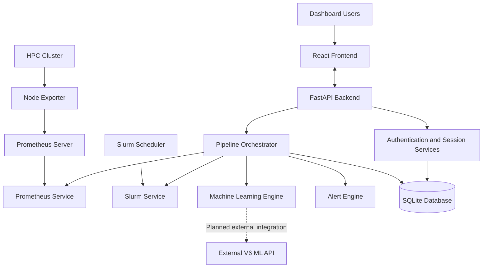
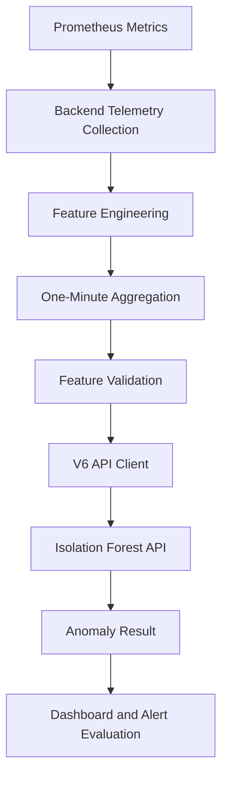
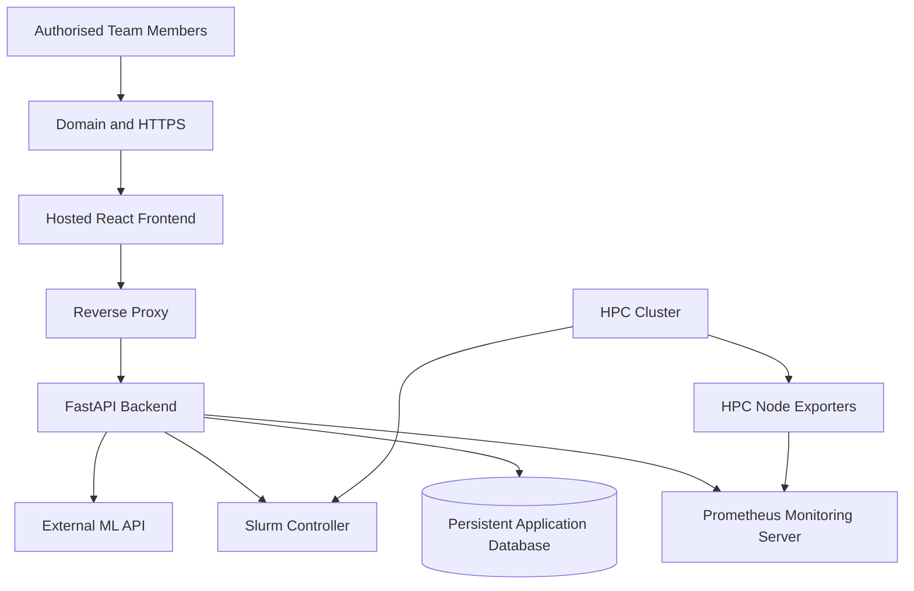

# HPC-Cluster-Monitoring-Dashboard
# HPC AIOps Dashboard
## Intelligent Monitoring, Analytics and Predictive Maintenance for High-Performance Computing Clusters

**Project:** HPC AIOps Dashboard  
**Repository:** `hpc-aiops-dashboard`  
**Application type:** Full-stack web application  
**Primary purpose:** Centralised HPC cluster monitoring, operational visibility, anomaly detection and predictive infrastructure monitoring.

---

# 1. Project Overview

## 1.1 Introduction

The HPC AIOps Dashboard is a web-based monitoring and analytics platform developed to provide a centralised view of the operational health and performance of a High-Performance Computing (HPC) cluster.

High-performance computing environments consist of multiple interconnected systems working together to execute computationally intensive workloads. These environments typically include a head node, compute nodes, shared storage, networking infrastructure, workload schedulers and monitoring services.

Monitoring such an environment requires more than simply checking whether individual machines are online. Administrators and researchers need visibility into resource utilisation, workload behaviour, system performance, node availability, resource contention and potential infrastructure failures.

The dashboard addresses this need by integrating cluster telemetry, monitoring services, workload information, analytics and machine-learning capabilities into a single interface.

The long-term objective is to move beyond traditional infrastructure monitoring towards an intelligent monitoring platform capable of identifying abnormal behaviour, recognising degradation patterns and assisting administrators in identifying potential infrastructure problems before they result in serious service interruptions.

## 1.2 Problem Statement

Traditional infrastructure monitoring systems generally provide metrics and threshold-based alerts. Although these tools are valuable, they may not always identify complex behavioural patterns that develop gradually across an HPC environment.

For example:

- A compute node may gradually experience increasing CPU utilisation.
- Memory availability may progressively decrease.
- Disk I/O wait may increase while CPU utilisation remains relatively normal.
- Network retransmissions may increase, indicating possible communication problems.
- A node may remain operational while its performance deteriorates.
- A workload may experience abnormal execution behaviour without immediately causing a system-level failure.

Monitoring individual metrics independently may not provide enough information to identify these patterns.

The HPC AIOps Dashboard aims to combine multiple sources of operational information and apply analytical techniques to provide a more comprehensive understanding of cluster behaviour.

## 1.3 Project Objectives

The project is designed around the following objectives:

1. Provide centralised visibility into HPC cluster health and performance.
2. Monitor individual nodes and cluster-wide resource utilisation.
3. Integrate Prometheus-based telemetry collection.
4. Incorporate workload and scheduler information through Slurm.
5. Present historical and real-time operational information.
6. Identify abnormal infrastructure behaviour using machine learning.
7. Provide intelligent alerts and diagnostic information.
8. Support administrative access and controlled team-member access.
9. Generate reports that assist with operational analysis.
10. Establish an architecture that can eventually support continuous model evaluation and real-time predictive monitoring.

## 1.4 Intended Users

The platform is intended for:

- HPC cluster administrators.
- Infrastructure engineers.
- Cluster architects.
- Research teams.
- Machine-learning engineers.
- Technical project members responsible for monitoring and maintaining the cluster.

---

# 2. Technology Stack

The dashboard uses a combination of frontend, backend, infrastructure monitoring, database and machine-learning technologies.

| Layer | Technology | Purpose |
|---|---|---|
| Frontend | React | Building the interactive user interface |
| Frontend tooling | Vite | Development server and frontend build tooling |
| Backend | Python | Backend application logic and data processing |
| API framework | FastAPI | REST API and WebSocket communication |
| Database | SQLite | Local application persistence |
| Monitoring | Prometheus | Collecting and querying infrastructure metrics |
| Metrics exporter | Prometheus Node Exporter | Exposing Linux host-level metrics |
| Workload management | Slurm | Providing HPC job and scheduler information |
| Remote connectivity | SSH | Secure communication with cluster infrastructure |
| Real-time communication | WebSockets | Delivering live monitoring updates |
| Authentication | PBKDF2-HMAC-SHA256 | Password hashing |
| Session management | Secure HTTP cookies | Maintaining authenticated user sessions |
| Machine learning | Scikit-learn and existing model artifacts | Local anomaly detection and predictive analytics |
| External ML integration | HTTPX | Communicating with the separate V6 ML API |
| Data analysis | Python and Pandas-compatible processing | Feature preparation and telemetry analysis |
| Source control | Git and GitHub | Version control and collaborative development |

The exact installed package versions should be maintained in the project's dependency files rather than assumed from this overview.

## 2.1 Why React?

React was selected for the frontend because the dashboard requires an interactive interface with multiple monitoring views, charts, status indicators, administrative pages and reusable components.

A component-based approach allows different dashboard sections to be developed independently.

For example:

- Overview pages can display cluster-wide KPIs.
- Node pages can display individual machine metrics.
- Analytics pages can display historical trends.
- Alerts pages can present detected operational issues.
- Settings pages can provide administrative configuration.

React also makes it easier to update individual parts of the interface as new monitoring capabilities are introduced.

## 2.2 Why Vite?

Vite provides the frontend development environment and production build tooling.

It offers a fast development server and a straightforward build process.

During local development, the frontend runs separately from the FastAPI backend, allowing both applications to be developed and tested independently.

The current development frontend uses port `5173`.

## 2.3 Why Python and FastAPI?

Python is particularly suitable for this project because it provides a strong ecosystem for:

- Infrastructure telemetry processing.
- Data analysis.
- Machine learning.
- Statistical analysis.
- Automation.
- Communication with external APIs.

FastAPI provides the backend HTTP API and WebSocket functionality.

The backend is responsible for coordinating the different system components, processing monitoring information, interacting with the database, evaluating model outputs and delivering information to the frontend.

The current development backend uses port `8000`.

## 2.4 Why Prometheus?

Prometheus is responsible for collecting and querying time-series infrastructure metrics.

Instead of relying on the dashboard to independently collect every operating-system metric, Prometheus provides a dedicated monitoring layer.

Node Exporter exposes Linux system metrics that Prometheus can scrape.

These metrics include:

- CPU utilisation.
- Memory utilisation and availability.
- System load.
- Disk activity.
- Filesystem utilisation.
- Network traffic.
- Network errors and drops.
- Running and blocked processes.
- System uptime.
- Additional operating-system performance indicators.

This separation is important because monitoring and visualisation should not be tightly coupled.

Prometheus focuses on metric collection and querying, while the dashboard focuses on interpreting and presenting the information.

## 2.5 Why Slurm?

Slurm is commonly used as a workload manager in HPC environments.

Infrastructure monitoring alone cannot explain everything happening inside a cluster.

For example, knowing that a compute node is using 90% CPU does not necessarily explain which workload is responsible.

Slurm provides information about jobs, their states and scheduling activity.

Integrating Slurm allows the dashboard to place infrastructure metrics into the context of HPC workload execution.

This is important when investigating:

- Running jobs.
- Pending jobs.
- Failed jobs.
- Job completion.
- Resource allocation.
- Node utilisation.
- Potential workload-related performance problems.

## 2.6 Why SQLite?

SQLite is used for local application persistence.

It is suitable for the current development environment because it does not require a separate database server.

The application database stores application-level information such as users, sessions, invitations and authentication events.

The database is not intended to replace Prometheus as the primary time-series monitoring database.

For a larger production deployment, a dedicated database service may be considered depending on the required concurrency, availability and persistence requirements.

---

# 3. System Architecture

## 3.1 Architectural Overview

The application follows a layered architecture.

The frontend handles user interaction and visualisation.

The backend coordinates authentication, monitoring, analytics, model evaluation and application services.

Prometheus collects infrastructure telemetry from the HPC cluster.

Slurm provides workload information.

The machine-learning layer evaluates prepared telemetry and returns analytical results.

The database stores application information and other persisted records.

The architecture is designed to keep these responsibilities separate.

## 3.2 High-Level Architecture



The diagram represents the intended overall architecture. The V6 API connection is a separate integration path and should not be interpreted as already being fully operational.

## 3.3 Data Flow

The monitoring process follows this general sequence:

1. Node Exporter exposes operating-system metrics on the HPC nodes.
2. Prometheus collects and stores the metrics.
3. The backend queries Prometheus for the latest cluster information.
4. The cluster connector obtains the telemetry snapshot.
5. The feature pipeline processes raw metrics into enriched features.
6. The machine-learning engine evaluates the prepared information.
7. The alert engine evaluates operational conditions and model outputs.
8. The backend combines the results into a dashboard response.
9. The frontend displays the information through monitoring pages, charts and status indicators.
10. Selected application and monitoring records are persisted for subsequent retrieval and analysis.

This approach separates metric collection, feature engineering, machine-learning evaluation and visualisation.

---

# 4. Backend Architecture

The backend is organised into separate services rather than placing all application functionality inside a single file.

The main application entry point is:

`backend/app/main.py`

It coordinates the API, monitoring pipeline, WebSocket communication and application lifecycle.

## 4.1 Important Backend Components

### `main.py` — Application Entry Point and Pipeline Orchestrator

This is the central backend application.

Its responsibilities include:

- Creating the FastAPI application.
- Registering API routes and middleware.
- Initialising application services.
- Coordinating monitoring cycles.
- Managing the pipeline orchestrator.
- Publishing real-time dashboard updates.
- Managing WebSocket connections.
- Exposing monitoring and administrative endpoints.

The `PipelineOrchestrator` coordinates the recurring monitoring process.

It fetches telemetry, processes features, invokes the machine-learning engine, evaluates alerts and prepares the resulting information for the frontend.

### `cluster_connector.py` — Cluster Data Connection

This service determines where monitoring information originates.

The connector currently supports different data-source modes:

- `live_prometheus`: Retrieves information from the live Prometheus monitoring environment.
- `scc_dataset_replay`: Replays an existing dataset.
- Cluster simulation: Generates simulated monitoring information for development and testing.

These modes serve different purposes.

Live Prometheus mode is intended for actual cluster monitoring.

Dataset replay is useful for evaluating dashboard behaviour against historical observations.

Simulation is useful when developing interface functionality without relying on a live cluster.

**Important:** Data originating from simulation or dataset replay must not silently be submitted to a production model intended to learn or monitor real cluster behaviour.

### `prometheus_service.py` — Prometheus Integration

This service handles communication with Prometheus.

It defines PromQL queries for retrieving infrastructure information.

Examples include:

- CPU utilisation.
- CPU I/O wait.
- Memory availability.
- Memory utilisation.
- System load.
- Disk read and write throughput.
- Disk I/O utilisation.
- Network receive and transmit throughput.
- Network errors.
- Network drops.
- Process information.
- Filesystem utilisation.
- System uptime.
- Available pressure-stall information where exposed.

The service converts the Prometheus query results into structured node information that can be processed by the rest of the backend.

### `feature_pipeline.py` — Feature Engineering

Raw monitoring values are useful, but machine-learning algorithms often require additional processing.

The rolling feature pipeline transforms incoming observations into enriched features.

Its responsibilities include:

- Maintaining recent observations.
- Calculating rolling averages.
- Calculating standard deviations.
- Identifying metric trends.
- Calculating normalised values.
- Comparing nodes against cluster peers.
- Producing additional workload-related indicators where available.

The current implementation uses a rolling history buffer.

Feature engineering is important because a single metric value does not always describe the behaviour of a system.

For example, a CPU utilisation value of 80% may be normal for one workload but unusual for a node that normally operates at 15%.

Historical behaviour and relationships between metrics provide additional context.

### `ml_engine.py` — Existing Machine-Learning Engine

This is the existing local model evaluation component.

It loads locally available machine-learning model artifacts and evaluates prepared node features.

The existing implementation supports model artifacts including:

- Feature scaler.
- Isolation Forest.
- One-Class SVM.
- Local Outlier Factor.
- K-Means.
- K-Means threshold configuration.
- Random Forest or XGBoost failure prediction model.
- Feature-column configuration.
- Model evaluation metadata.

The engine also has a fallback statistical or heuristic evaluation path when the expected model artifacts are unavailable.

This distinction matters.

The dashboard must identify whether results came from trained model artifacts or from the fallback heuristic.

A heuristic result should not be presented as if it came from a fully trained production model.

### `ml_engine_v6.py` — V6 API Client

This component is an HTTP client for a separate machine-learning service.

It is not itself the training implementation.

The client is designed to communicate with an external Isolation Forest API through HTTP requests.

The documented API operations include:

- `POST /observations`
- `POST /observations/batch`
- `GET /nodes/{node_id}/status`
- `GET /health`
- `GET /model/info`

The client also supports node warm-up and scoring operations.

The V6 API requires a history of 61 consecutive one-minute observations for a node before it can produce a normal score.

This requirement has important implications for integration.

The dashboard's monitoring loop currently operates at a much shorter interval than one minute. Therefore, the V6 service must receive correctly aggregated one-minute observations rather than every monitoring tick.

The backend must also ensure that:

- Timestamps are timezone-aware.
- Observations are correctly ordered.
- Required features are present.
- Duplicate observations are not submitted as separate minutes.
- Missing metrics are not silently replaced with fabricated values.
- Only the intended live cluster data source is used.
- The API key remains on the backend.

The V6 integration is being prepared separately from the existing local machine-learning engine.

### `alert_engine.py` — Intelligent Alert Evaluation

This service evaluates monitoring information and model outputs to identify conditions that require attention.

The purpose is to provide more meaningful operational alerts than simply displaying raw metric values.

Alert evaluation can consider infrastructure conditions and analytical outputs.

An anomaly score and a failure probability are different measurements.

An anomaly score indicates how unusual an observation is relative to a model's learned behaviour.

A failure probability requires a model specifically trained and calibrated to estimate failure likelihood.

The dashboard should preserve this distinction in its user interface and reports.

### `slurm_service.py` — Workload Scheduler Integration

This service provides access to Slurm-related information.

It allows the dashboard to incorporate workload information into cluster monitoring.

This makes it possible to investigate node behaviour alongside job activity rather than treating infrastructure metrics as isolated observations.

### `auth_service.py` — Authentication Services

This component manages authentication-related operations.

The authentication implementation includes:

- User records.
- Password verification.
- Session creation.
- Session validation.
- Session revocation.
- Authentication event recording.
- Invitation-related records.

Passwords are protected using PBKDF2-HMAC-SHA256 with a high iteration count and randomly generated salts.

Passwords should never be stored in plaintext.

### `auth_security.py` — Authentication Security

This component supports the application's security controls.

The implementation uses secure session handling and browser security mechanisms.

The application uses:

- HTTP-only session cookies.
- CSRF protection.
- Origin restrictions.
- Session validation.
- Protected API access.

The session cookie is named `hpc_session`, while the CSRF cookie is named `hpc_csrf`.

### `auth_dependencies.py` — Authentication Dependencies

This component provides authentication-related dependencies for protected backend routes.

It allows API endpoints to require an authenticated user rather than implementing separate authentication logic inside every endpoint.

### `database.py` — Database Management

This component manages application database access and persistence.

The current SQLite database contains application-level records such as:

- Users.
- Sessions.
- Authentication events.
- Invitations.

The database should be treated as application state and protected from accidental exposure or deletion.

### Additional Backend Services

Other backend modules include:

| File | Responsibility |
|---|---|
| `config.py` | Application configuration |
| `reports_service.py` | Report generation and reporting operations |
| `logs_diagnostics.py` | Log and diagnostic functionality |
| `ssh_bridge.py` | SSH communication bridge |
| `terminal_service.py` | Terminal-related operations |
| `prometheus_service.py` | Infrastructure metric retrieval |
| `feature_pipeline.py` | Feature engineering and rolling analysis |

---

# 5. Frontend Architecture

The frontend is built using React and Vite.

Its responsibility is to provide an interface through which authorised users can interact with the monitoring platform.

The frontend does not independently connect to the HPC nodes or hold machine-learning API credentials.

Instead, it communicates with the FastAPI backend.

## 5.1 Dashboard Sections

The application includes monitoring and administrative functionality such as:

### Overview

Provides a consolidated view of cluster health.

It is intended to help users understand the general operational state of the environment without inspecting every node individually.

### Node Monitoring

Provides node-level visibility.

Users can inspect resource utilisation and performance information for individual cluster machines.

### Analytics

Provides analytical views of infrastructure behaviour and historical monitoring information.

This is important when investigating gradual degradation and changes in system behaviour.

### Alerts

Displays operational conditions that require attention.

The alert interface should distinguish between threshold-based conditions, model-detected anomalies and confirmed failure predictions.

### Logs and Diagnostics

Provides access to diagnostic information useful when investigating node or application problems.

### Slurm and Workload Information

Provides visibility into workload-related information obtained from the scheduler integration.

### Reports

Provides reporting functionality for reviewing monitoring and operational information.

### Settings

Provides configuration and administrative functionality according to the user's assigned permissions.

---

# 6. Authentication, Security and Team Access

Security is a core part of the dashboard architecture.

The dashboard is designed for multiple team members rather than a single shared administrator account.

## 6.1 User Authentication

Users authenticate through the application's login process.

The backend verifies the supplied credentials and establishes an authenticated session.

The browser receives a session cookie.

The cookie is configured as HTTP-only so frontend JavaScript cannot directly read the session identifier.

The application also uses CSRF protection for state-changing requests.

## 6.2 Authentication Endpoints

The current authentication API includes:

| Endpoint | Method | Purpose |
|---|---|---|
| `/api/auth/csrf` | GET | Obtain CSRF information |
| `/api/auth/login` | POST | Authenticate a user |
| `/api/auth/me` | GET | Retrieve the current authenticated user |
| `/api/auth/logout` | POST | End the current session |

Protected API routes require authentication.

Mutating requests are additionally subject to CSRF protection.

## 6.3 User Roles

The dashboard uses role-based access control.

The intended roles include:

**Senior Admin**

Responsible for administrative management.

Administrative functionality includes managing users, reviewing access and changing authorised settings.

**Member**

A team member who has been granted access to the dashboard.

Members are intended to use the monitoring, analytics and operational functionality made available to them.

Administrative functionality should remain restricted.

## 6.4 Adding Team Members

The intended member onboarding process is invitation-controlled.

The general process is:

1. A Senior Admin opens the user-management section.
2. The administrator creates or issues an invitation.
3. The invitation is associated with the intended user or permitted email address, according to the configured invitation policy.
4. The member completes the registration process.
5. The backend validates the invitation and registration requirements.
6. The member account is created.
7. The account receives the appropriate member permissions.
8. The member signs in using their own credentials.

The invitation workflow is designed to prevent unrestricted public account registration.

Where approved email domains are configured, registration should also validate the user's email domain.

**Implementation note:** The exact registration and invitation screens, email delivery behaviour and domain-management controls must be verified against the current frontend and backend before being described as fully operational.

## 6.5 Security Considerations

The following rules should be followed by all developers:

- Never commit passwords, API keys or private credentials.
- Never expose the V6 API key to React or browser code.
- Never commit the production SQLite database.
- Do not disable authentication to make an API endpoint easier to test.
- Keep the CORS allowlist restricted to trusted frontend origins.
- Use HTTPS in production.
- Protect session cookies using appropriate production cookie settings.
- Apply access-control checks to administrative endpoints.
- Protect SSH credentials and private keys.
- Avoid exposing internal cluster services directly to the public internet.
- Keep development and production secrets separate.

---

# 7. Real-Time Monitoring

## 7.1 Monitoring Cycle

The backend uses a recurring monitoring process to retrieve and process cluster telemetry.

The current development pipeline uses a configurable monitoring interval, with a default interval of approximately three seconds.

Each monitoring cycle performs the following operations:

1. Retrieve a telemetry batch.
2. Identify the current nodes.
3. Process the raw node metrics.
4. Generate enriched features.
5. Evaluate the available machine-learning engine.
6. Evaluate alerts.
7. Combine the resulting information.
8. Update monitoring history and dashboard state.
9. Persist selected telemetry records.
10. Publish updates to connected frontend clients.

## 7.2 WebSocket Communication

WebSockets provide a persistent communication channel between the backend and the frontend.

This avoids requiring the frontend to repeatedly reload the entire dashboard to obtain new monitoring information.

The current live monitoring WebSocket endpoint is:

`/ws/live`

WebSocket connections are subject to authentication and trusted-origin checks.

## 7.3 Monitoring Data Sources

The dashboard distinguishes between different monitoring modes.

| Mode | Purpose | Suitable for production cluster monitoring? |
|---|---|---|
| Live Prometheus | Actual infrastructure telemetry | Yes |
| Dataset replay | Historical data analysis and testing | No, unless explicitly designed as a replay experiment |
| Cluster simulation | Development and interface testing | No |

This separation is especially important when integrating machine-learning models.

A model intended to monitor the real HPC cluster should not unknowingly receive simulated or replayed data.

---

# 8. Machine Learning and Predictive Monitoring

## 8.1 Purpose of Machine Learning

The machine-learning component is intended to help identify behaviour that may not be easily detected using fixed thresholds.

The long-term goal is to support predictive monitoring rather than relying entirely on reactive alerts.

Examples of behaviour that may be investigated include:

- Progressive performance degradation.
- Abnormal resource consumption.
- Unusual memory behaviour.
- Unexpected disk activity.
- Abnormal network behaviour.
- Node-level anomalies.
- Potential infrastructure failure signatures.

## 8.2 Existing Local Model Architecture

The existing local machine-learning engine loads model artifacts from the backend environment.

These artifacts are used to evaluate prepared node features.

The engine includes anomaly-detection approaches and a separate failure-prediction model where the required artifact is available.

The backend should report which model path is active.

This allows the dashboard to distinguish between:

- Trained model inference.
- Statistical or heuristic fallback.
- Model unavailable or not ready.

## 8.3 V6 Isolation Forest API

A separate V6 API is being integrated.

The API is responsible for processing incoming observations and returning anomaly-related results.

The dashboard acts as a client of this service.

The API is documented with a one-minute observation history requirement of 61 consecutive observations per node.

Consequently, a node must accumulate sufficient valid history before normal scoring can begin.

The initial period is a warm-up period, not evidence that the node is healthy.

## 8.4 Important Feature Requirements

The V6 client expects a specific set of metric names.

The current documented feature set includes:

1. `cpu_utilisation_pct_mean`
2. `iowait_pct_mean`
3. `memory_used_pct_mean`
4. `memory_free_pct_mean`
5. `network_rx_mib_s_mean`
6. `network_tx_mib_s_mean`
7. `tcp_retrans_per_s_mean`
8. `disk_read_mib_s_mean`
9. `disk_write_mib_s_mean`
10. `disk_io_time_pct_sum_mean`
11. `disk_io_now_mean`
12. `node_load1_per_core_mean`
13. `node_load5_per_core_mean`
14. `node_load15_per_core_mean`
15. `node_procs_running_mean`
16. `node_procs_blocked_mean`
17. `root_filesystem_used_pct_mean`

These fields must be mapped carefully from the actual Prometheus and feature-pipeline outputs.

The dashboard must not assume that a metric is available merely because it appears in the model's expected feature list.

Missing metrics must be identified and handled explicitly.

## 8.5 Model Integration Design

The recommended integration flow is:



The V6 API should receive one correctly prepared observation per node per minute.

The dashboard's shorter monitoring interval must not cause duplicate minute-level observations to be submitted.

The V6 API key must be stored in the backend environment.

The integration should also provide clear information about model availability, warm-up status, API errors and scoring latency.

## 8.6 Anomaly Detection Is Not Failure Prediction

This distinction is important for interpreting model results.

Anomaly detection identifies behaviour that differs from learned normal patterns.

Failure prediction attempts to estimate the likelihood of a future failure using an appropriately trained prediction model.

These outputs should not be treated as interchangeable.

The dashboard should not label an anomaly score as a failure probability.

---

# 9. Repository Structure

The following is the current known high-level repository organisation. The exact frontend subdirectories and additional deployment files should be verified against the latest repository before this section is treated as a complete file inventory.

```text
hpc-aiops-dashboard/
│
├── backend/
│   ├── app/
│   │   ├── main.py
│   │   ├── alert_engine.py
│   │   ├── auth_dependencies.py
│   │   ├── auth_security.py
│   │   ├── auth_service.py
│   │   ├── cluster_connector.py
│   │   ├── config.py
│   │   ├── database.py
│   │   ├── feature_pipeline.py
│   │   ├── logs_diagnostics.py
│   │   ├── ml_engine.py
│   │   ├── ml_engine_v6.py
│   │   ├── prometheus_service.py
│   │   ├── reports_service.py
│   │   ├── slurm_service.py
│   │   ├── ssh_bridge.py
│   │   └── terminal_service.py
│   │
│   └── .venv/
│
├── frontend/
│   └── React and Vite application
│
├── grafana/
│   └── Grafana configuration, where applicable
│
├── deployment/
│   └── Deployment scripts and configuration, where applicable
│
├── docs/
│   └── Project documentation
│
├── README.md
└── .gitignore
```

The Python virtual environment and local database should not be committed to Git.

Machine-learning artifacts, datasets, credentials and other large or sensitive files should be managed deliberately rather than committed automatically.

---

# 10. Local Development Setup

## 10.1 Prerequisites

Before running the dashboard, ensure that the development machine has:

- Python compatible with the backend dependencies.
- Node.js and npm.
- Git.
- Access to the project repository.
- Access to the relevant Prometheus instance if testing live monitoring.
- Access to the HPC cluster if testing Slurm and SSH functionality.

Prometheus and the cluster do not necessarily have to be available to start the frontend and backend, but live monitoring functionality will depend on their availability.

## 10.2 Clone the Repository

```powershell
git clone <REPOSITORY_URL>
cd hpc-aiops-dashboard
```

## 10.3 Start the Backend

Open PowerShell in the repository root.

Activate the existing virtual environment:

```powershell
.\backend\.venv\Scripts\Activate.ps1
```

Start the backend from the repository root using the project's configured module path:

```powershell
python -m uvicorn backend.app.main:app --host 127.0.0.1 --port 8000
```

The backend should be available at:

`http://127.0.0.1:8000`

Do not start another backend process on the same port if one is already running.

## 10.4 Start the Frontend

Open a second PowerShell window.

Navigate to the frontend directory:

```powershell
cd frontend
```

Install the dependencies if they have not already been installed:

```powershell
npm install
```

Start the Vite development server:

```powershell
npm run dev
```

The frontend should be available at:

`http://localhost:5173`

The frontend communicates with the backend through the configured API client.

## 10.5 Verify the Application

A successful local setup should allow the developer to:

1. Open the frontend.
2. Access the login interface.
3. Authenticate using an authorised account.
4. View the dashboard.
5. Confirm that the backend is responding.
6. Check whether Prometheus connectivity is available.
7. Inspect the monitoring source status.
8. Confirm that real-time updates are being received where the monitoring pipeline is active.

Protected backend endpoints may return an authentication error when accessed directly without a valid session. This is expected behaviour and should not be treated as proof that the backend is offline.

---

# 11. Environment Configuration

Configuration values and credentials should be supplied through environment variables or an appropriately protected configuration mechanism.

The following variables are relevant to the planned external V6 integration:

| Variable | Purpose |
|---|---|
| `V6_API_URL` | Base URL of the external V6 service |
| `V6_API_KEY` | API authentication key |

The V6 API client must use the correct endpoint supplied by the service owner.

A local default URL in the client must not automatically be assumed to be the deployed production endpoint.

Other backend configuration values may include database paths, Prometheus URLs, cluster connection settings and security configuration.

The actual names and defaults should be documented from the project's configuration module and deployment environment.

Never place real secrets in this README or commit them to the repository.

A safe example environment file may contain placeholders only:

```dotenv
V6_API_URL=http://127.0.0.1:18100
V6_API_KEY=replace_with_your_own_secret
```

The example values above are illustrative. They must be replaced with the endpoint and credentials appropriate to the environment.

---

# 12. Hosting and Production Deployment Architecture

## 12.1 Deployment Objective

The dashboard is intended to operate as a centrally accessible web application while maintaining secure communication with the HPC infrastructure and machine-learning services.

The production environment should separate the public-facing application from the internal cluster services.

The frontend should be accessible to authorised users through HTTPS.

The backend should coordinate monitoring, authentication and model communication.

Prometheus should continue collecting metrics from the HPC nodes.

The machine-learning service should remain accessible to the backend without exposing its credentials or internal interface to browser clients.

## 12.2 Recommended Production Architecture



This is the recommended target architecture, not a claim that production hosting has already been completed.

## 12.3 Frontend Hosting

The React application can be built into static production assets.

These assets can be hosted on a suitable static hosting service or served through a reverse proxy.

The production frontend should communicate with the backend using the HTTPS API address.

The development Vite server should not be used as the production hosting server.

## 12.4 Backend Hosting

The FastAPI backend should run as a persistent application service on a suitable Linux server or virtual machine.

It should be deployed behind a reverse proxy such as Nginx or an equivalent service.

The backend must have access to:

- The application database.
- Prometheus.
- Slurm information.
- Required SSH connectivity.
- The external machine-learning API.
- Required configuration and secrets.

The backend should be monitored independently to ensure that the dashboard does not become unavailable without detection.

## 12.5 Cluster Connectivity

The cluster should not need to expose all its internal infrastructure services publicly.

A preferred arrangement is to establish secure connectivity between the hosted backend and the cluster's monitoring environment.

Depending on the network design, this may use:

- A site-to-site VPN.
- A controlled private network connection.
- A secure tunnel.
- An approved bastion or gateway host.

The final approach must be agreed with the cluster's infrastructure or network administrators.

Prometheus and SSH access should be restricted to trusted systems.

## 12.6 Machine-Learning Service Hosting

The external ML service can run independently of the dashboard backend.

The backend communicates with it over an authenticated API.

This separation allows the model service to be updated or scaled without requiring the entire dashboard to be rebuilt.

The API key must remain on the server side.

The backend should handle service unavailability gracefully and report the model's current state to the frontend.

## 12.7 Production Database

SQLite is suitable for the current development setup.

For a production deployment with multiple application workers, concurrent users or stronger operational requirements, a managed or dedicated database such as PostgreSQL should be evaluated.

The production database must have:

- Persistent storage.
- Backups.
- Access controls.
- A documented recovery procedure.
- Appropriate retention policies.

Prometheus should remain responsible for time-series infrastructure telemetry rather than using the application database as a replacement.

## 12.8 Production Security

Before public deployment:

- Enforce HTTPS.
- Configure secure session-cookie attributes.
- Restrict allowed frontend origins.
- Protect administrative endpoints.
- Keep secrets outside source control.
- Restrict public access to internal monitoring services.
- Use dedicated service credentials.
- Review SSH permissions.
- Configure logging and backups.
- Establish a patching and dependency-update process.
- Test session expiry and revocation.
- Verify that WebSocket authentication works through the production reverse proxy.

---

# 13. Operational Usage Guide

## 13.1 Signing In

Users should access the dashboard using the approved application URL.

They must sign in using their own account.

Users should not share administrator credentials.

## 13.2 Monitoring the Cluster

The Overview page provides a high-level picture of cluster activity.

Users should check the monitoring source status to establish whether the dashboard is receiving live Prometheus information.

They should distinguish between live monitoring, dataset replay and simulation.

## 13.3 Investigating a Node

When a node appears abnormal:

1. Open the node monitoring section.
2. Inspect CPU utilisation.
3. Inspect memory availability and usage.
4. Review I/O wait.
5. Review disk activity.
6. Review network activity.
7. Inspect relevant process and workload information.
8. Review alerts and model outputs.
9. Investigate diagnostic logs where available.

A single abnormal metric should not automatically be treated as a confirmed hardware failure.

The surrounding metrics and workload context should also be considered.

## 13.4 Interpreting Alerts

Alerts should be interpreted according to their source.

A threshold alert indicates that a configured condition was met.

An anomaly alert indicates that a model detected behaviour that differs from learned patterns.

A failure prediction indicates an output from a model trained for failure prediction.

These categories should remain separate in operational reporting.

## 13.5 Managing Users

Only authorised administrators should perform user-management operations.

Administrators should issue invitations rather than share existing accounts.

Each team member should use an individual account so access can be reviewed and revoked independently.

---

# 14. Development and Contribution Guidelines

The project is intended to be developed collaboratively.

To maintain consistency, contributors should follow these principles.

## 14.1 Understand the Existing Architecture First

Before changing a service, identify which other components depend on it.

For example, changing the machine-learning output schema may affect:

- The monitoring orchestrator.
- Alert evaluation.
- Dashboard charts.
- Historical records.
- Reports.
- WebSocket payloads.

A change should not be considered complete until the affected components have been tested.

## 14.2 Preserve Existing Security

Authentication and authorisation are fundamental application features.

Do not remove security middleware or bypass authentication simply to test an endpoint.

When adding an API route, determine whether it should require authentication and which roles should be permitted to use it.

## 14.3 Maintain Clear Data Provenance

Every monitoring observation should have a known source.

The system should distinguish between:

- Live cluster telemetry.
- Historical dataset replay.
- Simulated observations.
- Model-generated outputs.

This is particularly important when developing or evaluating machine-learning models.

## 14.4 Validate Machine-Learning Inputs

Before sending data to an ML service:

- Validate required fields.
- Check timestamp formats.
- Check observation intervals.
- Check for missing values.
- Check for duplicate observations.
- Confirm metric units.
- Confirm node identity.
- Record API failures.

Do not silently invent missing telemetry values.

## 14.5 Test Before Committing

Contributors should test their changes before creating a pull request.

At minimum, test the affected backend or frontend functionality and ensure that existing authentication and monitoring functionality remains intact.

## 14.6 Git Workflow

A suggested workflow is:

```powershell
git pull
git checkout -b feature/your-feature-name

# Make and test your changes

git status
git add .
git commit -m "Describe the implemented change"
git push -u origin feature/your-feature-name
```

Changes should be reviewed before being merged into the main branch.

Do not commit:

- Virtual environments.
- Private API keys.
- Passwords.
- Local database files.
- SSH private keys.
- Unnecessary large datasets.
- Temporary logs containing sensitive information.

---

# 15. Known Technical Considerations and Limitations

The dashboard is an evolving system. The following considerations are important for anyone contributing to its development.

## 15.1 Hardware Telemetry Availability

Not every HPC environment exposes every hardware metric.

For example, CPU temperature, fan speed and power-consumption metrics depend on hardware support and available monitoring interfaces.

If the current cluster does not expose a particular metric, the dashboard cannot reliably infer it from unrelated measurements.

Unavailable hardware metrics should be identified as unavailable rather than represented as valid measurements.

## 15.2 Model Warm-Up

The V6 API requires 61 consecutive one-minute observations per node before normal scoring.

This means that a newly connected node may initially report a warm-up state.

A warm-up state is not equivalent to a healthy state.

## 15.3 External API Availability

The dashboard depends on the availability of external services where those integrations are enabled.

If the ML API is offline, the dashboard should continue operating where possible and clearly indicate that the external model is unavailable.

## 15.4 Prometheus Connectivity

If Prometheus becomes unavailable, the dashboard may not receive fresh infrastructure metrics.

The system should distinguish between a node that is genuinely down and a node whose telemetry source cannot be reached.

## 15.5 Historical Data Retention

Prometheus and the application database have different responsibilities.

Monitoring retention should be configured according to storage capacity and project requirements.

The application database should not be assumed to contain the complete historical telemetry history.

## 15.6 Production Deployment Is a Separate Milestone

A dashboard working locally does not automatically mean it is ready for public hosting.

Production deployment requires additional work around network connectivity, HTTPS, database persistence, monitoring, secrets, backups, access control and service reliability.

---

# 16. Development Roadmap

The following roadmap separates the current platform from the next stages of development.

| Area | Objective | Status |
|---|---|---|
| Frontend dashboard | React-based monitoring interface | Implemented |
| Backend API | FastAPI application | Implemented |
| Prometheus integration | Infrastructure metric retrieval | Implemented |
| Cluster connector | Live, replay and simulation modes | Implemented |
| Feature pipeline | Rolling feature engineering | Implemented |
| Existing ML engine | Local model evaluation and fallback | Implemented |
| Authentication | Secure sessions and authentication services | Implemented |
| Role-based access | Administrative and member permissions | Implemented in backend design; verify all route enforcement |
| Real-time updates | WebSocket monitoring | Implemented |
| Slurm integration | Workload information | Implemented in backend |
| Reporting and diagnostics | Operational reporting and diagnostics | Implemented in backend |
| V6 API client | External Isolation Forest client | Added; integration still in progress |
| V6 feature mapping | Validated one-minute feature aggregation | Pending |
| Continuous real-cluster model evaluation | Live observations and scoring | Pending |
| Model status in dashboard | Warm-up, ready, error and availability states | Pending |
| Production hosting | Secure hosted application | Planned |
| Production database | Evaluate PostgreSQL or equivalent | Planned |
| Deployment automation | Repeatable deployment and recovery | Planned |

---

# 17. Project Design Principles

The development of this dashboard follows several important principles.

**Separation of concerns**

Monitoring, feature engineering, machine learning, authentication and visualisation should remain separate responsibilities.

**Security by design**

Authentication, role-based access, secret management and secure communication must be considered during development rather than added as an afterthought.

**Real infrastructure data**

The ultimate monitoring system should operate using genuine cluster telemetry.

**Transparent machine learning**

The dashboard should communicate model status, input availability and output meaning accurately.

**Graceful degradation**

A failure in an external model service should not unnecessarily bring down the entire monitoring platform.

**Maintainability**

New functionality should be introduced in a way that does not unnecessarily break existing components.

**Scalability**

The architecture should allow the frontend, backend, monitoring services and model services to evolve independently.

---

# 18. Conclusion

The HPC AIOps Dashboard is intended to provide more than a visual representation of cluster metrics.

It is being developed as an integrated monitoring and analytics platform that brings together infrastructure telemetry, workload information, application security, feature engineering and machine-learning capabilities.

The current implementation establishes the foundation for this objective through a React frontend, FastAPI backend, Prometheus integration, cluster connector, feature pipeline, existing machine-learning engine, authentication services and real-time communication.

The next major development stage is to strengthen the integration between actual HPC telemetry and the external V6 machine-learning service, ensuring that the model receives correctly prepared observations from the live cluster.

The longer-term objective is to deploy the dashboard as a secure, centrally accessible service connected to the HPC environment and its associated analytical services.

The project should ultimately help administrators and technical teams move from simply observing infrastructure performance towards understanding, detecting and investigating abnormal system behaviour.

---

# 19. Documentation Maintenance

This README should be updated whenever a significant architectural change is introduced.

The documentation should accurately reflect the actual state of the codebase.

Planned functionality must not be described as completed functionality.

For more detailed technical explanations, the repository should gradually introduce supporting documents under the `docs/` directory.

Suggested supporting documentation:

- `docs/ARCHITECTURE.md` — detailed component architecture and data flow.
- `docs/INSTALLATION.md` — complete local installation instructions.
- `docs/AUTHENTICATION.md` — authentication, roles and member onboarding.
- `docs/MONITORING.md` — Prometheus, Node Exporter and Slurm integration.
- `docs/MACHINE_LEARNING.md` — model architecture, feature engineering and V6 integration.
- `docs/DEPLOYMENT.md` — production hosting and cluster connectivity.
- `docs/CONTRIBUTING.md` — development standards and Git workflow.

**Documentation principle:** If a feature, endpoint, configuration value or deployment process changes, update the relevant documentation alongside the implementation.
