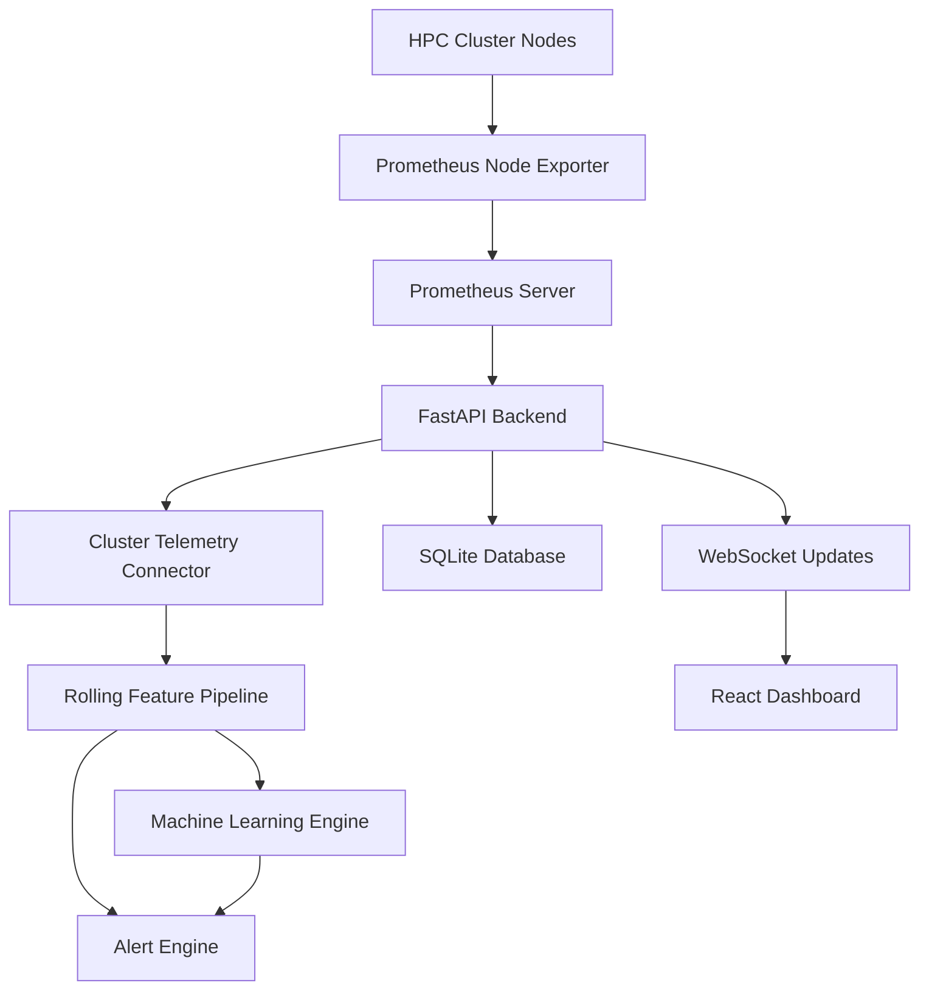

# Sol Plaatje A HPC AIOps Dashboard

**HPC Predictive Monitoring and AIOps Platform**

A monitoring and operational support platform developed for the Sol Plaatje University HPC development cluster. The application brings together cluster telemetry, node health monitoring, workload visibility, diagnostics, alert management, analytics, and machine-learning-assisted anomaly detection.

---

## 1. Project Overview

The Sol Plaatje A HPC AIOps Dashboard provides a central interface for observing and analysing the operational state of an HPC cluster.

It integrates with Prometheus-based monitoring services, processes incoming node metrics, maintains rolling feature information, evaluates node behaviour, and distributes monitoring updates to connected dashboard clients.

The current development environment is designed around a four-node HPC cluster:

- One head node.
- Three compute nodes.

The platform is intended to support HPC administrators and authorised team members by providing infrastructure visibility, diagnostic information, workload context, and operational decision support.

## 2. Key Features

| Area | Description |
|---|---|
| Overview | Displays cluster health, Slurm job counts, and separate service status indicators. |
| Infrastructure Topology | Visual representation of head node and compute nodes with multi-evidence health states. |
| Node Monitoring | Detailed real-time node telemetry, comparison table, collector health, and CSV export. |
| AI Model Centre | Separate monitoring, toggle controls, and evaluation of V7 Isolation Forest and LSTM V8. |
| AI Intelligence Centre | Gemini LLM workspace for cluster chat, incident investigation, and NL analytics. |
| Workload Intelligence | Slurm job queue, accounting history, node impact correlation, and safe controls. |
| Node Logs & Diagnostics | Retrieves journald / node logs and cluster diagnostic bundles. |
| Incidents & Alerts | Multi-source (telemetry, V7, LSTM V8) alert episodes, notes, and Gemini investigation links. |
| Experiments & Evaluation | Labelled fault-injection and baseline windows to evaluate V7 vs LSTM V8 vs thresholds. |
| Historical Analytics | Historical telemetry trends, node comparisons, and availability analysis. |
| Reports | CSV, PDF, experiment evaluation, and Gemini AI operational report archive. |
| System Settings | Integration endpoints, persistent model/terminal/email toggles, and JSON/SQLite backups. |
| User Management | Role-based access control (`super_admin`, `admin`, `viewer`), invitations, and audit trail. |
| Operations Terminal | Policy-gated, audited administrative console with command allowlists & secret redaction. |

Some capabilities depend on external services, cluster connectivity, user permissions, and available model artefacts.

## 3. Technology Stack

### Frontend

- React 18
- Vite 6
- Tailwind CSS 4
- Recharts
- Lucide React

### Backend

- Python
- FastAPI
- Uvicorn
- Pydantic
- SQLite
- Prometheus Client
- Requests
- NumPy
- Pandas
- Scikit-learn
- Joblib

### Infrastructure and Monitoring

- Prometheus
- Prometheus Node Exporter
- Slurm Workload Manager
- SSH
- Linux systemd

### Technology Rationale

**React and Vite**

React provides a component-based interface for the dashboard, while Vite supports rapid development and production builds.

**FastAPI**

FastAPI provides REST API and WebSocket functionality while allowing the backend to use Python's data-processing and machine-learning ecosystem.

**Prometheus**

Prometheus provides metrics collection and querying capabilities. Node Exporter exposes operating-system metrics from the HPC nodes.

**SQLite**

SQLite provides lightweight persistent storage for application settings, telemetry history, alert episodes, audit records, and authentication data. It complements Prometheus rather than replacing it as the primary metrics collection system.

**WebSockets**

WebSockets allow the backend to distribute live monitoring updates to connected frontend clients.

**Slurm**

Slurm integration provides workload and scheduler context relevant to HPC operations.

## 4. System Architecture

The application follows a telemetry-processing and monitoring workflow.

### Data Flow

1. Prometheus collects metrics exposed by the cluster nodes.
2. The backend retrieves telemetry through the cluster connector.
3. The feature pipeline maintains rolling node-level and cluster-level information.
4. The machine-learning engine evaluates node observations.
5. The alert engine evaluates operational conditions and prediction outputs.
6. Relevant application information is persisted in SQLite.
7. The orchestrator broadcasts updated cluster snapshots through WebSockets.
8. The React frontend displays monitoring, diagnostics, and analytical information.

### High-Level Architecture



For an as-built architecture overview, see [System Overview and Requirements](docs/SYSTEM_OVERVIEW_REQUIREMENTS.md).

## 5. Repository Structure

```text
hpc-aiops-dashboard/
│
├── backend/
│   ├── app/
│   │   ├── main.py
│   │   ├── config.py
│   │   ├── database.py
│   │   ├── cluster_connector.py
│   │   ├── prometheus_service.py
│   │   ├── feature_pipeline.py
│   │   ├── ml_engine.py
│   │   ├── ml_engine_v6.py
│   │   ├── alert_engine.py
│   │   ├── auth_service.py
│   │   ├── auth_security.py
│   │   ├── auth_dependencies.py
│   │   ├── slurm_service.py
│   │   ├── ssh_bridge.py
│   │   ├── terminal_service.py
│   │   ├── logs_diagnostics.py
│   │   └── reports_service.py
│   │
│   ├── requirements.txt
│   ├── create_admin.py
│   └── test_*.py
│
├── frontend/
│   ├── src/
│   │   ├── components/
│   │   ├── context/
│   │   ├── pages/
│   │   ├── App.jsx
│   │   ├── api.js
│   │   └── main.jsx
│   │
│   └── package.json
│
├── grafana/
│
├── docs/
│   ├── ARCHITECTURE.md
│   ├── INSTALLATION.md
│   ├── AUTHENTICATION.md
│   ├── MACHINE_LEARNING.md
│   ├── DEPLOYMENT.md
│   ├── API_REFERENCE.md
│   ├── CONTRIBUTING.md
│   └── OPERATIONS.md
│
├── deploy-headnode.sh
├── start-dashboard.ps1
└── README.md
```

The structure above highlights the main project components. Additional files and directories may exist as the project evolves.

The SQLite database is generated and maintained by the application and should not be committed if it contains user information, session records, or other sensitive data.

## 6. Monitoring and Data Sources

The dashboard supports multiple monitoring modes through the cluster telemetry connector.

### Live Prometheus Monitoring

In live mode, the backend retrieves actual metrics from the configured Prometheus server.

Depending on exporter availability, monitored measurements include:

- CPU utilisation.
- CPU I/O wait.
- Memory availability and utilisation.
- Swap usage.
- System load averages.
- Disk read and write activity.
- Filesystem utilisation.
- Network traffic.
- Network errors and drops.
- Process information.
- Context switches.
- Pressure-stall information.
- Hardware sensor measurements where available.

Live telemetry availability depends on the monitoring configuration and the metrics exposed by the cluster.

When Prometheus is unavailable, the connector must represent the telemetry as unavailable rather than fabricating live measurements.

### Simulation Mode

Simulation mode generates synthetic monitoring observations for interface development and controlled testing.

### Dataset Replay Mode

Dataset replay mode processes historical or prepared observations for testing and analysis.

Synthetic and replayed observations must be distinguished from genuine live cluster measurements when evaluating model behaviour.

## 7. Machine Learning and Predictive Monitoring

The dashboard incorporates a machine-learning pipeline intended to support anomaly detection and predictive HPC monitoring.

### Feature Engineering

The rolling feature pipeline maintains recent observations and generates derived information, including:

- Rolling means.
- Rolling standard deviations.
- Metric slopes.
- Peer-node comparisons.
- Normalised load.
- Rolling z-scores.
- Node-level deviations.
- MPI straggler-related indicators.

### Existing Model Components

The current model engine supports loading available model artefacts, including:

- Isolation Forest.
- One-Class SVM.
- Local Outlier Factor.
- K-Means.
- Random Forest failure model.
- XGBoost failure model.

The actual execution path depends on the availability of the required artefacts and configuration.

Where trained artefacts are unavailable, the engine can use statistical or heuristic fallback behaviour. Such fallback outputs must not be interpreted as predictions from a fully trained model.

### External V6 Model Integration

The backend also contains an external V6 model API client.

This client supports observation submission, node status retrieval, model information, and history warm-up.

The V6 integration is an inference client, not a complete real-time model training system.

The longer-term development objective is to establish a validated real-time data collection, training, evaluation, model versioning, and deployment workflow.

The [System Overview and Requirements](docs/SYSTEM_OVERVIEW_REQUIREMENTS.md) describes the current pipeline and its integration boundaries.

## 8. Authentication and Security

The application implements session-based authentication and role-based access control.

Current roles:

| Role | Description |
|---|---|
| `member` | Standard authorised dashboard user. |
| `senior_admin` | User with elevated administrative permissions. |

Security mechanisms include:

- Password hashing using PBKDF2-HMAC-SHA256.
- Secure random session token generation.
- Hashed session token storage.
- Session expiry and revocation.
- CSRF protection.
- Trusted-origin validation.
- Authenticated WebSocket connections.
- Backend permission enforcement.

Sensitive operations, including selected Slurm actions, terminal execution, and settings management, are restricted to senior administrators.

Invitation-based registration and configurable email-domain approval should not be considered operational until their complete workflows have been implemented and verified.

Authentication configuration and deployment checks are covered in [Deployment Guide](docs/DEPLOYMENT.md).

## 9. Installation and Local Development

### Prerequisites

- Python 3.10 or later.
- Node.js and npm.
- Git.
- Access to a Prometheus server for live monitoring.
- Access to an HPC environment for cluster integration.

### Clone the Repository

```bash
git clone <YOUR_GITHUB_REPOSITORY_URL>
cd hpc-aiops-dashboard
```

Replace the placeholder with the actual repository URL.

### Backend Setup

```bash
cd backend

python -m venv .venv
```

Activate the environment on Windows:

```powershell
.venv\Scripts\Activate.ps1
```

Install dependencies:

```bash
pip install -r requirements.txt
```

Start the backend:

```bash
python -m uvicorn app.main:app --host 0.0.0.0 --port 8000 --reload
```

Backend environment variables (configured via `backend/.env` or shell environment, kept strictly backend-only):

- `V7_API_URL`, `V7_API_KEY`, `V7_TIMEOUT` — cluster V7 Isolation Forest API (`GET /scores/latest`)
- `LSTM_V8_API_URL`, `LSTM_V8_API_KEY`, `LSTM_V8_TIMEOUT` — cluster LSTM V8 temporal forecaster API
- `GEMINI_API_KEY`, `GEMINI_MODEL` — Google Gemini LLM API for AI Intelligence & report generation
- `BREVO_API_KEY`, `BREVO_SENDER_EMAIL`, `BREVO_SENDER_NAME` — optional P1 incident email & OTP delivery

### Frontend Setup

Open another terminal:

```bash
cd frontend
npm install
npm run dev
```

### Access the Application

Frontend:

`http://localhost:5173`

Backend:

`http://localhost:8000`

For head-node deployment, see the [Deployment Guide](docs/DEPLOYMENT.md).

## 10. Deployment

The repository includes scripts for local development and a baseline Linux head-node deployment.

### Windows Development

The `start-dashboard.ps1` script automates local startup of the frontend and backend.

### Linux Head-Node Deployment

The `deploy-headnode.sh` script builds the frontend, installs backend dependencies, and creates and starts a systemd service. It does not configure HTTPS, reverse proxying, firewall rules, secrets, or database backups.

Before using it on a shared host, review the service account and configure production authentication secrets, secure cookies, TLS, network restrictions, and database backups. Follow the [Deployment Guide](docs/DEPLOYMENT.md).

The baseline script performs these steps:

- Frontend production build.
- Python virtual environment setup.
- Backend dependency installation.
- systemd service configuration.
- Automatic service startup.

## 11. API and Integration

The backend exposes REST endpoints and an authenticated WebSocket interface.

Main API areas include:

- Authentication.
- Monitoring state.
- Model status.
- Slurm operations.
- Node diagnostics.
- Terminal operations.
- Analytics.
- Reports.
- Fault injection.
- Alert management.
- Application settings.

The live monitoring WebSocket endpoint is:

`/ws/live`

FastAPI's interactive API documentation is available at `/docs` when the service is running.

## 12. Database and Persistence

The application uses SQLite to persist selected application information.

Database tables include:

- `alert_episodes`
- `slurm_actions_audit`
- `system_logs`
- `telemetry_history`
- `app_settings`
- `ai_reports`
- `model_score_observations`
- `experiments`
- `gemini_conversations`
- `terminal_audit_logs`
- `auth_users`
- `auth_sessions`
- `auth_invitations`
- `auth_audit_logs`

Prometheus remains responsible for infrastructure metrics collection and querying.

Database retention and backup policies should be reviewed as the monitoring environment grows.

## 13. Testing and Development

Backend tests cover areas including:

- Authentication flows.
- Authentication services.
- CSRF protection.
- Member permissions.
- Role permissions.
- WebSocket authentication.

Run relevant backend tests using the configured Python environment:

```bash
cd backend
.\.venv\Scripts\python.exe -m unittest discover -s tests -v
```

For frontend build verification:

```bash
cd frontend
npm run build
```

Use the verification commands above after making changes, and review the relevant deployment and system overview documents before a release.

## 14. Project Documentation

The current project documents are:

| Document | Description |
|---|---|
| [System Overview and Requirements](docs/SYSTEM_OVERVIEW_REQUIREMENTS.md) | As-built architecture, data flow, integrations, and requirements. |
| [Deployment Guide](docs/DEPLOYMENT.md) | Linux head-node deployment, security configuration, and production checks. |

## 15. Current Development Status

The project currently brings together:

- React-based monitoring dashboard.
- FastAPI backend.
- Prometheus telemetry integration.
- Rolling feature engineering.
- Machine-learning model integration.
- Alert processing.
- SQLite persistence.
- Authentication and role-based permissions.
- Slurm and diagnostic integrations.
- Linux deployment support.

Further development is focused on improving the predictive monitoring pipeline, establishing a reliable real-time training and evaluation workflow, strengthening operational capabilities, and improving deployment readiness.

Features that depend on external infrastructure, model artefacts, or incomplete integration workflows should be evaluated in their actual deployment environment before being considered production-ready.

## 16. Security Considerations

Before deploying the application in a shared or production HPC environment:

- Use HTTPS.
- Enable secure session cookies.
- Restrict trusted origins.
- Protect administrator accounts.
- Keep API keys and SSH credentials outside source control.
- Restrict administrative endpoints.
- Apply appropriate firewall rules.
- Back up the SQLite database.
- Review audit records.
- Validate all operational actions.

The dashboard is an operational support tool and does not replace established HPC administration, security, or incident-response procedures.

## 17. Project Context

**Project:** Sol Plaatje A HPC AIOps Dashboard

**Institution:** Sol Plaatje University

**Environment:** HPC Development Cluster

**Focus Areas:**

- High-Performance Computing.
- Infrastructure Monitoring.
- Predictive Analytics.
- Machine Learning.
- Anomaly Detection.
- Cluster Operations.
- AIOps.

---

*Sol Plaatje A HPC AIOps Dashboard - Bringing intelligent monitoring and operational visibility to HPC infrastructure.*
