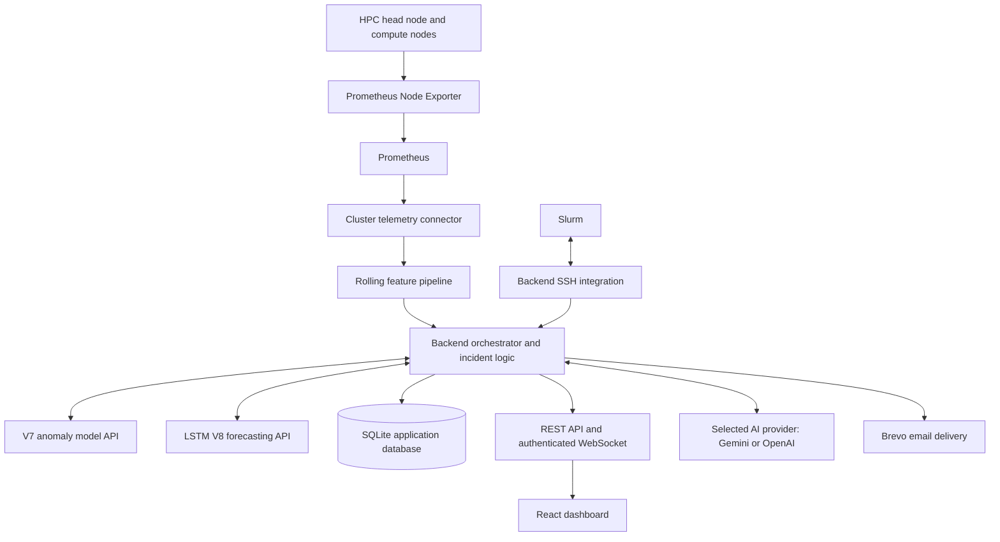

# Sol Plaatje University HPC Predictive Monitoring Dashboard

**HPC Predictive Monitoring Platform**

A web-based monitoring and operational support platform developed for the Sol Plaatje University HPC development cluster. It brings together infrastructure telemetry, cluster topology, Slurm workload visibility, node diagnostics, incident management, model integrations, analytics, reporting, and evidence-grounded AI assistance.

> **Release documentation baseline:** 18 November 2026. The feature names, role identifiers, authentication workflow, and demonstration terminology in this README follow the latest dashboard update guide supplied for that release. Repository source and deployed-release alignment should be checked before reproducing a production deployment from a clean checkout.

## Contents

- [Project purpose](#project-purpose)
- [Dashboard capabilities](#dashboard-capabilities)
- [Architecture and data flow](#architecture-and-data-flow)
- [Technology stack and design decisions](#technology-stack-and-design-decisions)
- [Monitoring data and provenance](#monitoring-data-and-provenance)
- [Predictive monitoring and model integrations](#predictive-monitoring-and-model-integrations)
- [Authentication, roles, and security](#authentication-roles-and-security)
- [External services and configuration](#external-services-and-configuration)
- [Data storage and retention](#data-storage-and-retention)
- [Repository layout](#repository-layout)
- [Local development](#local-development)
- [Deployment and operations](#deployment-and-operations)
- [Verification snapshot](#verification-snapshot)
- [Known limitations and future work](#known-limitations-and-future-work)
- [Demonstration screenshots](#demonstration-screenshots)

## Project purpose

The dashboard provides a unified operational view of an HPC development cluster. It combines node-level telemetry with scheduler, diagnostic, incident, and model information so that administrators can investigate infrastructure behaviour with more context than metrics alone provide.

The development environment described for this project consists of four nodes:

- One head node.
- Three compute nodes.

The application is intended for authorised cluster team members and administrators. It is an operational support and research platform; it does not replace the scheduler, monitoring infrastructure, established administration procedures, or human incident response.

### Project focus

- High-Performance Computing (HPC) operations.
- Infrastructure and node monitoring.
- Telemetry processing and feature engineering.
- Anomaly detection and time-series model integration.
- Workload and scheduler context.
- Incident investigation and operational reporting.
- Role-controlled administrative workflows.

## Dashboard capabilities

The current sidebar is organised into the following groups.

| Group | Screens | Purpose |
|---|---|---|
| **Overview** | Dashboard Overview | Cluster summary, status indicators, and operational overview. |
| **Infrastructure** | Cluster Topology; Live Telemetry; Node Logs & Diagnostics | Node relationships, current measurements, logs, and diagnostic evidence. |
| **Intelligence** | Models Centre; AI Assistant; Incident Management; Workload Intelligence | Model status and observations, evidence-grounded assistance, incidents, and Slurm workload context. |
| **Operations** | Operations Terminal | Policy-controlled operational access for authorised administrators. |
| **Analytics** | Model Evaluation; Performance Analytics; Reports | Model assessment, historical analysis, and generated/exportable reports. |
| **Administration** | System Configuration; User Management | Supported system settings and account administration. |

Operations Terminal and System Configuration are administrator-only. User Management is restricted to `super_admin`. These interface restrictions are supplemented by backend API authorization; hiding a screen in the frontend is not the security boundary.

### Recent feature updates

**Navigation and screen organisation**

- Expandable sidebar groups for Overview, Infrastructure, Intelligence, Operations, Analytics, and Administration.
- Responsive/mobile navigation and active-screen state.
- Breadcrumbs for nested Models Centre views.

**Models Centre**

- Model registry with model-specific status, health/freshness, summaries, and observation history for configured integrations.
- Observation filtering and detail inspection.
- Administrators can select a 15-day or 30-day observation-retention period.
- Cleanup targets model-observation rows and records when cleanup occurred; it is not a general database wipe.

**AI Assistant**

- Explicit Gemini or OpenAI provider selection.
- Conversation history and conversation management.
- Evidence context drawn from dashboard data.
- Conversations are scoped to their owner.
- Provider credentials remain on the backend. Provider selection is explicit: the application should report a provider failure rather than silently switching to another provider.

**Incident Management**

- Incident status, supporting evidence, and triage workflows bring telemetry and configured model signals into an operational investigation view.
- AI-generated investigation text is advisory and should be checked against the underlying evidence.

**Workload Intelligence**

- The Slurm jobs table uses the label **Run date** for the job start timestamp.
- Active queue entries use Slurm `squeue` start-time output (`%S`); recent accounting entries use `sacct` `Start`.
- Pending jobs display **Not started**. If Slurm supplies no usable start timestamp, the table displays `-`.
- Run date means job start time, not submission time. Display formatting follows the browser locale.

## Architecture and data flow

The application uses a React frontend and a Python/FastAPI backend. The backend coordinates telemetry retrieval, feature processing, scheduler and diagnostic integrations, model-service polling, application persistence, and client updates.



### Main processing flow

1. Node Exporter exposes operating-system metrics from monitored Linux nodes.
2. Prometheus scrapes exporters and provides query access to current and historical time-series data.
3. The backend connector queries Prometheus and normalises discovered node observations.
4. The feature pipeline derives rolling and comparative features from available telemetry.
5. Configured V7 and LSTM V8 services are polled independently; their outputs retain their own model identity and freshness.
6. Operational rules and configured model signals contribute to incident and cluster-status processing.
7. The backend persists selected application records in SQLite.
8. REST endpoints serve page-specific data and an authenticated WebSocket distributes live dashboard snapshots.
9. The frontend presents telemetry, model status, workload context, incidents, reports, and diagnostics.

Slurm and node-log information are obtained through the configured cluster access path, including SSH where required. AI requests use the provider explicitly selected for the interaction and supplied dashboard evidence as context.

## Technology stack and design decisions

The following explains the role of the technologies in the current implementation. Alternatives are listed as design options, not as products that were necessarily benchmarked in this project. No comparative performance benchmark is claimed.

| Layer | Technology | Why it is used | Alternatives / trade-offs |
|---|---|---|---|
| Frontend | React 18 | Component-based UI supports reusable dashboard screens and stateful operational workflows. | Vue or Angular could also support component-driven interfaces; migration would add cost without a demonstrated need. |
| Frontend tooling | Vite 6 | Provides the development server and production build pipeline used by the frontend. | Webpack is more configurable but typically requires more build configuration; Next.js adds server-rendering capabilities not required by the current same-origin dashboard. |
| Styling | Tailwind CSS 4 | Utility-based styling supports consistent layouts and responsive screen design. | Bootstrap or a component library can accelerate standard UI patterns but may impose more predefined visual structure. |
| Charts | Recharts | React-oriented chart components suit telemetry and historical time-series views. | Chart.js is a general-purpose charting option; D3 offers lower-level control at a higher implementation cost. |
| Backend API | FastAPI and Pydantic | Python API framework and typed request/response validation; supports REST endpoints and WebSocket routes. | Flask is a smaller framework with more extension choices; Django provides a broader integrated application framework. |
| ASGI server | Uvicorn | Runs the FastAPI application as an ASGI service. | Other ASGI servers are possible; deployment should be based on operational requirements and testing. |
| Application database | SQLite | Embedded relational persistence avoids a separate database service for the current single-instance deployment model. | PostgreSQL or MySQL are stronger candidates when concurrent writes, multi-instance deployment, or operational scale justify a dedicated DBMS. SQLite has concurrency and scaling limits; PostgreSQL is a possible future migration, not a current deployment claim. |
| Metrics collection/query | Prometheus | Scrapes and stores time-series metrics and exposes PromQL queries used by the dashboard backend. | Zabbix or Nagios provide different monitoring/alerting models; InfluxDB is another time-series option but would change the collection and query architecture. |
| Host metrics | Prometheus Node Exporter | Exposes Linux host and operating-system metrics in a Prometheus-compatible format. | Telegraf or custom exporters are alternatives where additional collection plugins or application-specific metrics are required. |
| Scheduler | Slurm | Provides HPC job queue and accounting context, including job state and start-time information. | PBS Pro and IBM Spectrum LSF are other schedulers; integration depends on the scheduler actually deployed by the cluster. |
| Cluster access | SSH | Supports remote scheduler operations and node-log/diagnostic retrieval where configured. | A dedicated agent or scheduler/API integration may reduce SSH dependence but requires additional infrastructure and access design. |
| Live updates | WebSockets | Supports server-to-client dashboard snapshot updates over a persistent connection. | Polling is simpler but repeatedly requests data; Server-Sent Events are suitable for one-way server-to-browser streams. |
| Data processing | NumPy and Pandas | Support numerical operations and tabular telemetry/feature processing. | Polars may be considered if measured data-volume or processing requirements justify a change. |
| ML integration | scikit-learn and Joblib | Provide the Python ecosystem for classical model artefacts and model-related utilities in the project. | PyTorch or TensorFlow are options for deep-learning workflows, but introduce different model-development and serving requirements. |
| Email | Brevo | Delivers transactional invitation, verification, login-code, and configured notification emails. | SMTP or another transactional email provider could be substituted by changing the integration and operational configuration. |
| AI assistance | Gemini and OpenAI | Provide selectable language-model services for evidence-grounded assistance and report interpretation. | A locally hosted model can reduce external API dependence but introduces hardware, serving, maintenance, and model-quality considerations. |

### Design principles

- Keep Prometheus as the infrastructure metrics system; SQLite stores application records and selected telemetry history rather than replacing Prometheus.
- Keep AI provider credentials and cluster SSH configuration on the backend.
- Preserve source and freshness information so unavailable or stale upstream data is not mistaken for current measurements.
- Keep V7 anomaly scores and LSTM V8 forecasts distinct; do not merge them into an unsupported consensus score.
- Prefer incremental changes that preserve the existing API and operational workflows.
- Treat alternatives as candidates for future evaluation. A technology is not described as superior based on an unperformed benchmark.

Useful primary references: [React](https://react.dev/), [Vite](https://vite.dev/), [Tailwind CSS](https://tailwindcss.com/docs), [FastAPI](https://fastapi.tiangolo.com/), [SQLite](https://www.sqlite.org/docs.html), [Prometheus](https://prometheus.io/docs/), [Node Exporter](https://github.com/prometheus/node_exporter), [Slurm](https://slurm.schedmd.com/documentation.html), [scikit-learn](https://scikit-learn.org/stable/), and [Recharts](https://recharts.org/).

## Monitoring data and provenance

The live monitoring path is Prometheus-based. Depending on exporter and host support, the dashboard can work with measurements such as:

- CPU utilisation and I/O wait.
- Memory and swap utilisation.
- System load and process information.
- Disk I/O and filesystem utilisation.
- Network traffic, errors, and drops.
- Pressure-stall information and other available Linux metrics.
- Exporter reachability, scrape status, and telemetry freshness.

### Live, simulated, and replayed data

The connector supports live Prometheus data and non-live modes used for development, demonstrations, or analysis. Synthetic and replayed observations must remain distinguishable from genuine live cluster measurements. If Prometheus or an exporter is unavailable, the application should report unavailable/stale data rather than fabricate live measurements.

**Hardware telemetry limitation:** the current cluster does not expose usable `hwmon` readings for CPU temperature, fan speed, power, or energy. These values are therefore unavailable and must not be inferred, fabricated, or treated as required for general monitoring health.

## Predictive monitoring and model integrations

The project explores machine-learning-assisted HPC monitoring using time-series and node-level telemetry. Feature engineering can derive rolling statistics, trends, and peer-node comparisons from the metrics actually available.

### Configured model integrations

- **V7 anomaly model:** an external service integration that retrieves the latest node-level anomaly observations/scores.
- **LSTM V8:** an external temporal forecasting integration that can provide short-horizon forecasts and warning/residual information.
- **Model registry and observations:** the dashboard tracks configured model identity, status, health/freshness, summaries, and observation history.

The backend integration clients are not, by themselves, evidence that a model is currently reachable, enabled, trained on the latest cluster data, or producing valid predictions. Model status and observation freshness must be checked in the running environment.

### Interpretation rules

- Prometheus telemetry is observed infrastructure data.
- V7 outputs are anomaly-model results.
- LSTM V8 outputs are forecast/warning results.
- AI Assistant responses are language-model interpretations of supplied evidence, not independent predictive model outputs.
- A suspected cause is a hypothesis until corroborated by logs, workload context, telemetry, or an operator investigation.
- No model accuracy, failure-prediction rate, or performance improvement is claimed here without a reproducible evaluation result.

The longer-term research direction is to strengthen a reproducible data collection, feature engineering, training, evaluation, versioning, and deployment workflow using the target cluster's own data. Historical datasets from a different cluster should not be presented as measurements from this cluster. Any controlled fault-injection observations must be labelled as experimental.

## Authentication, roles, and security

### Current documented sign-in workflow

The 18 November 2026 release guide describes passwordless OTP sign-in:

1. A `super_admin` sends a single-use invitation with an assigned role and expiry.
2. The invitee registers through the invitation and verifies their email address.
3. An eligible, verified user requests a six-digit email login code.
4. The code expires after five minutes; verification attempts and resend frequency are limited.
5. Successful OTP verification establishes an authenticated session.

The current release guide specifies the following administrative controls:

- List, reissue, and revoke pending invitations.
- Inspect user details and authentication audit history.
- Assign roles and deactivate/reactivate accounts.
- Permanently revoke access and issue a reinstatement invitation.
- Retain account and audit records when access is revoked rather than hard-deleting the account.
- Prevent self-revocation and protect the last active `super_admin`.
- Avoid public login responses that disclose whether an email belongs to an eligible account.

### Canonical roles

| Role | Responsibility |
|---|---|
| `super_admin` | Full user-account and invitation administration. |
| `admin` | Operational administration for permitted dashboard controls. |
| `viewer` | Standard read-oriented dashboard access. |

Use these role IDs exactly. `member` and `senior_admin` are legacy labels and are not current role IDs.

### Security boundaries

- Backend authorization must protect restricted API operations; frontend visibility is not sufficient.
- Authentication and administrative events should be recorded in the audit trail.
- Session cookies should be HTTP-only and configured securely for HTTPS deployment.
- Authentication secrets, email-provider credentials, AI API keys, and SSH key material must remain backend-side and outside source control.
- Operational terminal commands and scheduler actions require server-side validation, authorization, and auditability.
- The AI Assistant should receive only the evidence needed for the requested task; generated recommendations remain advisory.

**Source alignment note:** the release guide is the feature reference for the workflow above. The authentication implementation currently visible in the repository's committed backend still contains password-based request fields and password-related registration logic. The checked-in source must be brought into alignment with the documented passwordless release before a clean checkout can be treated as an exact reproduction of that release. This README documents the stated release behaviour; it does not claim that this source discrepancy has been resolved.

## External services and configuration

| Service / component | Purpose | Configuration names (names only; never commit values) |
|---|---|---|
| Prometheus | Cluster metrics queries and history | `PROMETHEUS_URL` |
| SSH / Slurm / node diagnostics | Scheduler and remote diagnostic access | `HPC_SSH_HOST`, `HPC_SSH_USER`, `HPC_SSH_PORT`, `HPC_SSH_KEY_PATH` |
| V7 model API | Latest anomaly observations | `V7_API_URL`, `V7_API_KEY`, `V7_TIMEOUT` |
| LSTM V8 model API | Forecast and warning observations | `LSTM_V8_API_URL`, `LSTM_V8_API_KEY`, `LSTM_V8_TIMEOUT` |
| Gemini | AI Assistant / report generation | `GEMINI_API_KEY`, `GEMINI_MODEL` |
| OpenAI | Alternative explicitly selected AI provider | `OPENAI_API_KEY`, `OPENAI_MODEL`, `OPENAI_TIMEOUT_SEC` |
| Brevo | Invitation, email verification, login OTP, and configured email notifications | `BREVO_API_KEY`, `BREVO_SENDER_EMAIL`, `BREVO_SENDER_NAME` |
| Authentication | Session and cookie configuration | `AUTH_SECRET_KEY`, `AUTH_SESSION_HOURS`, `AUTH_COOKIE_NAME`, `AUTH_COOKIE_SECURE` |
| Frontend origin | Invitation links and browser origin | `FRONTEND_BASE_URL` |

The email sender display name is **Sol Plaatje A Dev Cluster Dashboard** (`BREVO_SENDER_NAME`). The verified sender mailbox is configured separately using `BREVO_SENDER_EMAIL`. A display name does not prove that a sender mailbox/domain has been verified.

Integration availability depends on configuration, network access, provider limits, credentials, and upstream service health. The API health endpoint indicates API process health only; it does not validate every external integration.

## Data storage and retention

SQLite stores selected application data, including telemetry history, incidents, model observations and registry metadata, experiments, settings, AI conversations, reports, authentication records, and operational audit entries.

Prometheus remains responsible for infrastructure metrics collection and time-series querying. SQLite complements it with application-level persistence.

The Models Centre's 15-day/30-day retention control applies to model-observation history. Its cleanup action is not a general retention policy for every SQLite table. Database-wide backup, restore, and retention procedures should be managed separately.

SQLite is suitable for the current lightweight, single-instance application model. If concurrent write volume, multi-instance operation, or recovery requirements grow, evaluate PostgreSQL and a migration plan rather than assuming the existing SQLite deployment will scale indefinitely.

## Repository layout

The repository contains the application source, supporting model artefacts, and deployment/documentation material. The main development application directories are:

```text
.
├── backend/
│   ├── app/
│   │   ├── main.py
│   │   ├── config.py
│   │   ├── database.py
│   │   ├── cluster_connector.py
│   │   ├── prometheus_service.py
│   │   ├── feature_pipeline.py
│   │   ├── v7_service.py
│   │   ├── lstm_v8_service.py
│   │   ├── slurm_service.py
│   │   ├── auth_routes.py
│   │   ├── auth_service.py
│   │   └── ...
│   ├── models/
│   ├── tests/
│   ├── requirements.txt
│   └── .env.example
├── frontend/
│   ├── src/
│   ├── package.json
│   └── vite.config.js
├── V7 model/
│   ├── HPC_Anomaly_Detection_V7.ipynb
│   └── ...
├── dashboard/
│   ├── backend/
│   ├── frontend/
│   ├── docs/
│   └── deployment scripts
├── docs/
│   ├── SYSTEM_OVERVIEW_REQUIREMENTS.md
│   └── DEPLOYMENT.md
└── README.md
```

The repository currently contains more than one application directory. Do not assume the root and nested `dashboard/` copies are interchangeable: compare their source and release state before using either as a deployment source. The root `backend/` and `frontend/` paths above describe the root development application.

Do not commit live SQLite databases, user data, environment files, API credentials, email-provider keys, or private SSH keys.

## Local development

### Prerequisites

- Python 3.10 or later (use the version supported by the selected dependencies).
- Node.js and npm.
- Git.
- Access to Prometheus for live telemetry.
- Appropriate cluster access for Slurm and remote diagnostics.

### Clone the repository

```bash
git clone https://github.com/PatDevWorks/HPC-Cluster-Monitoring-Dashboard.git
cd HPC-Cluster-Monitoring-Dashboard
```

### Backend

```bash
cd backend
python -m venv .venv
```

Activate the environment:

**Windows PowerShell**
```powershell
.venv\Scripts\Activate.ps1
```

**Linux**
```bash
source .venv/bin/activate
```

Install dependencies and configure a local backend environment using `backend/.env.example` as the reference. Keep real credentials out of Git.

```bash
pip install -r requirements.txt
python -m uvicorn app.main:app --host 127.0.0.1 --port 8000 --reload
```

### Frontend

In a second terminal:

```bash
cd frontend
npm install
npm run dev
```

The frontend development server is configured for port 5173 and the API uses port 8000. Check the Vite proxy/origin configuration and backend CORS settings if the browser cannot reach the API.

FastAPI's interactive API documentation is normally available at `http://127.0.0.1:8000/docs` when enabled by the running application.

## Deployment and operations

The repository includes deployment documentation and a head-node deployment script under the nested `dashboard/` application directory. The deployment guide describes a Linux/systemd baseline; it is not a complete production hardening solution.

Before deployment, review the exact application copy and commit being deployed, configure backend-only secrets, verify the service account and file permissions, and establish HTTPS/reverse-proxy, firewall, backup, restore, and log-review procedures. Do not expose the application port directly to untrusted networks.

The service name used by the deployment baseline is `spu-hpc-aiops.service`. The unauthenticated `/api/health` endpoint reports API process health only. Independently verify Prometheus, Node Exporter, Slurm/SSH, model APIs, email delivery, and AI providers before a demonstration or operational handover.

For the host setup and deployment baseline, see [Deployment Guide](docs/DEPLOYMENT.md). For architecture and requirements, see [System Overview and Requirements](docs/SYSTEM_OVERVIEW_REQUIREMENTS.md).

## Verification snapshot

The release guide records the following checks for the 18 November 2026 deployment:

| Check | Recorded result |
|---|---|
| Frontend production build | Passed; Vite emitted a bundle-size advisory that did not fail the build. |
| Targeted authentication and account-management tests | 14 passed. |
| Backend Python syntax compilation | Passed. |
| `spu-hpc-aiops.service` | Active after restart. |
| `/api/health` | Returned healthy. |
| Live SQLite integrity check | `ok`. |

These are release-snapshot results supplied for the deployed release, not a claim that this GitHub checkout has been independently rebuilt or redeployed during this documentation update. Email, Gemini, OpenAI, Prometheus, and Slurm remain dependent on their live configuration and upstream availability. Check the dashboard's own source/status indicators before relying on an integration.

## Known limitations and future work

- **Source/release alignment:** the committed authentication routes still contain password-based logic while the 18 November release guide describes passwordless OTP sign-in. Align and verify the source before treating a fresh checkout as the exact deployed release.
- **Hardware sensors:** CPU temperature, fan speed, power, and energy readings are not available from the current cluster's exposed `hwmon` interfaces.
- **External dependencies:** Prometheus, SSH/Slurm, model APIs, email, and AI providers can be unavailable or misconfigured independently of API process health.
- **Model evaluation:** publish accuracy, detection quality, latency, and comparative performance only when supported by reproducible experiments and clearly described datasets.
- **Training lifecycle:** continue developing a reproducible real-time collection, training, evaluation, versioning, and deployment workflow. Existing model API polling is not equivalent to an end-to-end live training pipeline.
- **Database growth:** review SQLite concurrency, backup, restore, and retention needs as use expands; PostgreSQL is a potential future option, not the current database.
- **Operational resilience:** formalise backup scheduling, restore testing, service recovery, security review, and integration-specific health checks.
- **Research validity:** keep observations from the target cluster distinct from external-cluster datasets, synthetic data, replay, and controlled fault-injection experiments.

## Demonstration screenshots

The following screenshots are planned demonstration assets. Use fictional demonstration accounts and non-sensitive sample data. Redact OTPs, invitation links, API keys, private host addresses, and personal account information.

| Screen | Suggested file | Screenshot focus |
|---|---|---|
| Dashboard Overview | `docs/screenshots/dashboard-overview.png` | Cluster status cards and grouped sidebar. |
| Cluster Topology | `docs/screenshots/cluster-topology.png` | Head node, compute nodes, and node-state indicators. |
| Live Telemetry | `docs/screenshots/live-telemetry.png` | Node metrics and telemetry/source status. |
| Models Centre | `docs/screenshots/models-centre.png` | Registry cards and model health/freshness. |
| AI Assistant | `docs/screenshots/ai-assistant.png` | Provider selector, conversation list, and evidence details. |
| Incident Management | `docs/screenshots/incident-management.png` | Incident status, evidence summary, and triage controls. |
| Workload Intelligence | `docs/screenshots/workload-intelligence.png` | Slurm job table with **Run date** visible. |
| User Management | `docs/screenshots/user-management.png` | Invitation and account controls with fictional identities. |
| Login verification email | `docs/screenshots/login-verification-email.png` | Branded email layout with the code redacted. |
| Invitation email | `docs/screenshots/invitation-email.png` | Invitation, assigned role, and redacted link. |

After adding an image, embed it in the relevant section using standard Markdown, for example:

```markdown

```

---

**Sol Plaatje University HPC Predictive Monitoring Dashboard**  
*Monitor • Analyse • Predict • Optimise*
