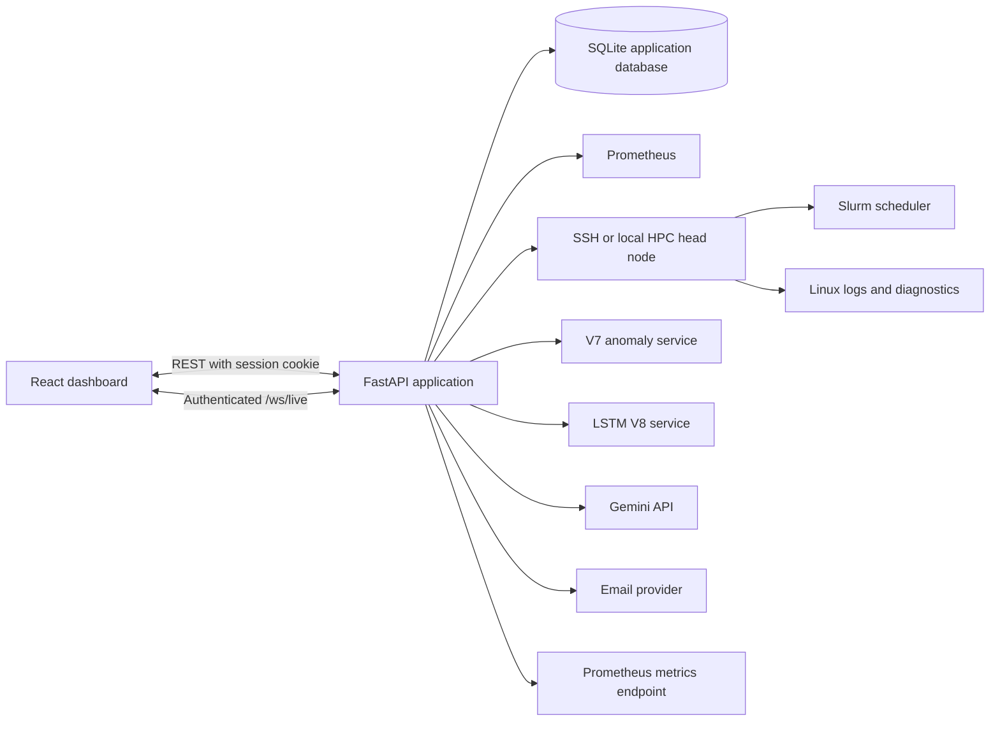

# System Overview and Requirements

**Project:** Sol Plaatje A HPC AIOps Dashboard  
**Document basis:** Repository inspection, 14 November 2026  
**Status:** As-built description; requirements are derived from current implementation.

## 1. Purpose and scope

The dashboard is a browser-based monitoring and operations interface for the Sol Plaatje University HPC development cluster. It combines infrastructure telemetry, scheduler and workload context, node diagnostics, anomaly and incident views, historical analysis, AI-assisted investigation, and selected administrative controls. It supports operational decisions; it does not replace HPC administration or incident-response procedures.

Some capabilities depend on reachable infrastructure and configured external services. Simulation and dataset-replay data are available for development and evaluation and must not be interpreted as live cluster evidence.

## 2. Architecture

The frontend is a React 18 single-page application built with Vite. It fetches initial state over REST and receives live snapshots over `/ws/live`. The FastAPI backend owns authentication, orchestration, integrations, persistence, and API authorization. SQLite stores application data; Prometheus remains the infrastructure metrics source. SSH provides optional access to Slurm and host diagnostics. V7, LSTM V8, Gemini, and transactional email are separate integrations.

The default configured topology has one management/head node and three compute nodes. The backend refresh interval defaults to three seconds and is bounded to one through sixty seconds.

## 3. How the system works

1. On startup, FastAPI initializes SQLite, loads settings, synchronizes model enablement, attempts initial model refreshes, and warms the telemetry pipeline (two iterations in live mode, fourteen in other modes).
2. The cluster connector fetches a telemetry batch from live Prometheus, simulation, or dataset replay.
3. The rolling feature pipeline enriches node observations. V7 and LSTM V8 are polled independently when enabled; available scores and status are joined into the node snapshot.
4. The alert engine evaluates operational thresholds and available model evidence, applying persistence and cooldown rules. Telemetry, model observations, incidents, logs, experiments, reports, and audit information are persisted in SQLite where implemented.
5. The orchestrator publishes periodic snapshots over the WebSocket and serves current and historical information through REST.
6. The frontend presents the data in dedicated views: overview, topology, monitoring, predictions, AI intelligence, jobs, logs, terminal, alerts, experiments, analytics, reports, settings, and user management.

Pausing the stream stops regular collection/broadcast cycles. An administrator can request a one-off refresh. Unavailable or stale integrations are represented with status information; cached results are not equivalent to fresh inference.

## 4. Functional requirements

These requirements describe implemented functions and integrations, rather than independently validated acceptance criteria.

### FR-1 Authentication and user administration

- Users shall sign in with email and password and complete an email one-time password (OTP) challenge before a server-side session is established.
- The backend shall expose session verification and logout, store session tokens securely, expire/revoke sessions, and protect authenticated APIs.
- Authorized administrators shall manage invitations and user roles/active status. Authentication and administrative events shall be auditable.

### FR-2 Cluster state and monitoring

- The system shall expose cluster and node snapshots, provide periodic updates over authenticated `/ws/live`, and offer an administrator-triggered refresh.
- The dashboard shall show available node health and telemetry, including CPU, memory, load, storage, network, and exporter availability.
- The backend shall support live Prometheus, simulation, and dataset-replay modes, test Prometheus connectivity, and configure refresh cadence.
- Users shall query historical telemetry and export supported telemetry views to CSV.

### FR-3 Topology and diagnostics

- Users shall inspect cluster topology and navigate to node monitoring and logs.
- Where host connectivity permits, the system shall retrieve and filter node logs and provide selected-log, node-diagnostic, and cluster-diagnostic downloads.
- Diagnostic results shall report connectivity/source status when live host data cannot be retrieved.

### FR-4 Models, predictions, and evaluation

- The system shall expose status and available scores/history from the separately configured V7 Isolation Forest and LSTM V8 services.
- Administrators shall enable/disable model integrations. Enabled integrations shall be polled and available results exposed to the dashboard and alert processor.
- The system shall expose model comparison/evaluation and experiment records for labelled evaluation windows, including supported CRUD operations.
- Disabled, disconnected, stale, or missing model results shall be identified as such and not treated as current inference.

### FR-5 Alerts and incidents

- The system shall create incident episodes from configured operational thresholds and available model signals, applying persistence and repeat-suppression policy.
- Users shall list/filter episodes and apply supported triage actions (acknowledge, silence, resolve, notes) subject to route authorization.
- Incident views shall link to node context and diagnostics and may invoke AI investigation. Stale offline-Prometheus incidents may be auto-resolved by the pipeline.

### FR-6 Slurm and workload operations

- Where local or SSH Slurm access is configured, users shall view queue/accounting and node/workload context.
- Administrators shall be able to drain/resume nodes and cancel jobs. High-impact actions shall have confirmation in the UI; reason fields and audit logging are provided for relevant actions.
- Responses shall make execution mode and failures clear; simulated or unavailable operations must not be presented as successful live scheduler changes.

### FR-7 Terminal and fault lab

- The system shall offer a policy-controlled terminal using command presets/allowlists, target validation, secret redaction, and audit records as implemented by the terminal/SSH services.
- In non-live modes, supported terminal output may be emulated and should be distinguishable from real host command output.
- Users shall be able to inject and clear supported demonstration faults for testing/evaluation, with access enforced by the applicable API route.

### FR-8 AI assistance and reports

- When configured, Gemini-backed functionality shall support cluster chat, incident investigation, analytics questions, and operational report generation.
- The system shall persist conversation/report information and provide report status, archive, preview, and export operations.
- AI output is advisory and dependent on provider availability and supplied evidence.

### FR-9 Settings, audit, and export

- Administrators shall manage supported Prometheus/Grafana endpoints, refresh cadence, SSH connection settings, model toggles, terminal/email toggles, alert policy, recipient addresses, and node overrides.
- The system shall expose relevant operational/authentication audit history, SQLite/settings backup downloads, and application metrics at `/metrics`.

## 5. Non-functional requirements

### NFR-1 Security and authorization

- Passwords and session tokens shall not be stored in plaintext. The implementation hashes passwords and server-side session tokens.
- Session cookies shall be HTTP-only; secure-cookie behavior is configurable. OTPs are time-limited and delivered through the configured email integration.
- Authorization shall be enforced by backend API dependencies, not only by frontend visibility. WebSocket connections shall validate a user session.
- API credentials and SSH key material shall remain backend-side. Terminal input and target identifiers shall use service validation/allowlists, and sensitive actions should be audited.
- Deployment shall configure a strong `AUTH_SECRET_KEY`, HTTPS, secure cookies, trusted origins, secret storage, and appropriate network restrictions. Current CORS origins are localhost development addresses.

### NFR-2 Availability and dependency handling

- The API and interface should report optional dependency state and continue operating when integrations are unavailable where possible. The background polling loop logs iteration failures and continues.
- Live data depends on Prometheus/exporters; Slurm and host logs depend on SSH/local access; AI/model/email functions depend on configured external services and credentials.
- `/api/health` indicates API process health only; it does not establish health of every integration.

### NFR-3 Performance and freshness

- Snapshot cadence shall be configurable from one to sixty seconds, defaulting to three seconds. V7 and LSTM V8 polling services use five-second defaults in the orchestrator.
- Staleness and alert repeat suppression are configurable; defaults include a 120-second telemetry stale threshold and 30-minute alert cooldown.
- No end-to-end latency, concurrency, throughput, or service availability SLA is specified in the repository.

### NFR-4 Data integrity and traceability

- The application shall persist supported telemetry history, incidents, audit records, model observations, experiments, settings, AI conversations, and reports in SQLite.
- Consumers should preserve provenance/status so live, simulated, replayed, cached, stale, and unavailable values remain distinguishable.
- Backup downloads exist, but automated off-host backup, restore objectives, and retention periods are not defined in code.

### NFR-5 Maintainability and compatibility

- Frontend and backend have separate dependency manifests and modular source. FastAPI/Pydantic request models and shared frontend API helpers define key interfaces.
- Browser support, API compatibility/versioning, database migration policy, and external contract versioning are not formally specified.

### NFR-6 Observability and operations

- The service shall expose health, Prometheus metrics, application logs, integration status, and audit history as implemented.
- Startup and polling failures shall be diagnosable from backend logs. Operators can export diagnostic bundles and database/settings backups.
- Deployment scripts cover local development and a Linux head-node baseline. TLS termination, automated recovery, resource limits, and production service monitoring require deployment configuration.

### NFR-7 Usability

- The dashboard shall group workflows into dedicated pages, support node navigation, confirm high-impact scheduler actions, and show operation failures to users.
- Responsive sidebar/navigation and an error boundary are implemented. Formal accessibility, localization, and usability targets are not specified.

## 6. Main components

| Component | Responsibility | Source |
|---|---|---|
| Frontend shell | Authentication state, navigation, snapshot/WebSocket lifecycle, confirmations | `frontend/src/App.jsx`, `frontend/src/api.js` |
| API and orchestrator | FastAPI lifecycle, REST/WebSocket endpoints, telemetry/model/alert composition | `backend/app/main.py` |
| Cluster connector | Prometheus, simulation/replay, node inventory | `backend/app/cluster_connector.py`, `prometheus_service.py` |
| Features and alerts | Rolling enrichment and operational incident generation | `backend/app/feature_pipeline.py`, `alert_engine.py` |
| Persistence | SQLite schema and application data access | `backend/app/database.py` |
| Authentication | OTP, sessions, route dependencies, audit | `auth_service.py`, `auth_routes.py`, `auth_dependencies.py` |
| HPC operations | SSH, Slurm, terminal, logs, diagnostics | `ssh_bridge.py`, `slurm_service.py`, `terminal_service.py`, `logs_diagnostics.py` |
| AI and model integrations | V7, LSTM V8, Gemini, incident intelligence, model registry | `v7_service.py`, `lstm_v8_service.py`, `gemini_service.py`, related routers |
| Reports and evaluation | Report generation/export and model comparison | `reports_service.py`, `evaluation_service.py` |

## 7. Configuration and assumptions

Important backend environment settings include `AUTH_SECRET_KEY`, `AUTH_SESSION_HOURS`, `AUTH_COOKIE_SECURE`, `PROMETHEUS_URL`, `HPC_SSH_HOST`, `HPC_SSH_USER`, `HPC_SSH_PORT`, `HPC_SSH_KEY_PATH`, `V7_API_URL`/`V7_API_KEY`, `LSTM_V8_API_URL`/`LSTM_V8_API_KEY`, `GEMINI_API_KEY`/`GEMINI_MODEL`, and email-provider configuration. The complete environment contract should be maintained with `.env.example` and deployment instructions.

The system assumes correct node identity mapping, reachable and correctly authenticated upstream services, a trustworthy system clock for OTP and timestamps, and appropriately permissioned Slurm/SSH users. The repository does not define production SLOs, disaster-recovery targets, model accuracy thresholds, or retention periods.

## 8. Caveats and verification items

- The README refers to a `docs/` suite not present in the inspected checkout; this file supplies an as-built overview and requirements document.
- README role descriptions do not fully match API authorization: route guards in `main.py` currently require `super_admin` or `admin` for the administrator dependency. Confirm role provisioning and intended permissions before deployment.
- README descriptions of older in-process model artifacts do not represent the current orchestrator, which reports the legacy model engine removed and integrates V7/LSTM V8 services.
- Feature availability depends on external services. API health alone does not confirm Prometheus, Slurm, SSH, Gemini, email, V7, or LSTM health.
- HTTPS, production origin allowlisting, secure-cookie defaults, backup schedule, audit retention, and service objectives need environment-specific decisions and verification.

## 9. Suggested operational acceptance evidence

Before production sign-off, verify that live data is distinguishable from simulation/replay; WebSocket authentication and reconnect behavior work; all administrative APIs enforce the intended roles; Slurm actions are audited and clearly distinguish live from simulated execution; stale model results cannot be treated as fresh; SSH-unavailable diagnostic and terminal results are labeled; database backup/restore is rehearsed; and HTTPS, secure cookies, origin controls, and secret handling are configured.

## 10. Upgrade brief audit and implementation map (Phase 1)

The attached upgrade brief was reviewed against the current repository. This section separates existing building blocks from gaps; it is an implementation map, not a record that the proposed upgrade is already complete.

### 10.1 Existing functionality that should be reused

| Brief area | Current implementation | Audit assessment |
|---|---|---|
| V7 and LSTM model services | `v7_service.py`, `lstm_v8_service.py`, clients, model status/toggle routes, snapshot integration | Operational integration paths exist; actual health/freshness still depends on external API responses and connectivity. |
| Model observations | `model_score_observations` SQLite table; persistence helpers; `/api/models/observations/{model_name}` | Base storage and retrieval exist. Retrieval only filters model and limit, with no date/node/classification/flagged filters or retention policy. |
| Model registry | `/api/models/registry` in `model_registry_router.py` | Exists, but `REGISTERED_MODELS` is a hard-coded list and reports static `active`/`ready` values. It is not derived from integration status/configuration and is not extensible through a backend registration mechanism. |
| Incident management | Existing alert episodes and `incident_service.py` list/evidence endpoints; fuller incident logic/routes in `main.py` | Incident records and evidence correlation exist. Evidence currently selects recent same-node model observations and Slurm actions; it does not show time-window correlation logic in the inspected router. |
| Gemini | `gemini_service.py`; `/api/ai/*` routes in `main.py`; `gemini_intelligence_router.py` with `/api/gemini/query`; persisted Gemini messages | Two distinct implementations exist. The intelligence router directly calls a fixed Gemini model without a timeout, passes recent DB rows as context, and does not use the shared service abstraction. Main chat/investigation/report paths use `gemini_service.py`. Consolidation/audit is needed. |
| Conversation persistence | `gemini_conversations` table and `main.py` history/chat routes | Message persistence exists. The inspected schema is message/session oriented and includes `user_email`; full conversation objects, rename/delete/search, provider metadata, and explicit conversation ownership/access APIs are not established. |
| LLM providers | Gemini service/configuration | OpenAI provider abstraction and OpenAI health check are absent in the inspected code. Gemini connectivity test exists through the shared service path; verify behavior with credentials in the target environment. |
| Navigation | `Sidebar.jsx`, `App.jsx`, page modules | Fourteen flat sidebar items already map to working page components. Sidebar collapse and mobile drawer are present. No grouped expandable sections or breadcrumb/detail-route system is visible. |
| Workload/operations | Slurm, SSH, terminal, logs, audit services/pages | Existing functionality should be preserved and reorganized in place rather than duplicated. |
| Theme | CSS variables and theme context | Existing theme infrastructure is present and should be reused for light/dark parity. |

### 10.2 Security and correctness items to resolve early

- The inspected `model_registry_router.py`, `incident_service.py`, and `gemini_intelligence_router.py` route declarations do not show authentication dependencies. These routers are included in `main.py`; confirm intended exposure and add backend authorization before exposing sensitive observations, incidents, or LLM context. This is a code-level finding from the inspected route definitions, not a deployment scan.
- The registry's fixed version strings, purpose/features, monitored node names, and readiness values may diverge from configured services and actual provider model configuration. In particular, Gemini registry metadata must not be treated as evidence that Gemini is configured or healthy.
- The model observation table stores generic `score`, `threshold`, `flagged`, `classification`, and `details_json`; model-specific forecasts/features may be represented inside `details_json`. UI must render only fields actually present and preserve raw details.
- The standalone `/api/gemini/query` router uses `requests.post` without an explicit timeout and includes raw upstream error response text in an HTTP error. It should be assessed for secret/data leakage and availability behavior. The shared service path should be the canonical integration point if compatible.
- Existing model endpoint names and dashboard-to-model node aliases differ (`head-node` vs `headnode`, `compute-01` vs `compute001`); filters and joins must normalize consistently.
- Do not implement automatic provider fallback. The brief calls for visible provider selection and explicit/auditable fallback only.

### 10.3 Proposed phased implementation map

1. **Phase 1 — Repository audit (current):** inspect routes, pages, sidebar, services, schema, auth, and reusable UI; record current/partial/missing behavior. No application-code changes in this phase. This document is the audit artifact.
2. **Phase 2 — Models Centre backend:** make registry data reflect configured V7/LSTM/Gemini integration metadata and runtime status; add honest health/readiness/freshness fields; extend observation filtering; implement admin-controlled 15/30-day retention and transactional cleanup using the existing observation table. Keep incidents and audit rows untouched.
3. **Phase 3 — Models Centre frontend:** replace/extend the existing AI Model Centre into registry, model detail, health, and observation-history views; use backend data; show only returned model-specific fields; preserve current evaluation/toggle workflows and existing theme.
4. **Phase 4 — Unified LLM architecture:** inspect and consolidate Gemini calls behind a provider interface; add optional backend-only OpenAI configuration/client, provider health endpoints, timeouts/error handling, and provider/model metadata. Keep dashboard startup independent of OpenAI availability.
5. **Phase 5 — AI Assistant:** evolve the existing AI Intelligence Centre and persisted chat path into multi-conversation UI with explicit provider selection, prompts grounded in real system data, evidence display, and conversation ownership/access. Do not grant the LLM command execution capability.
6. **Phase 6 — Navigation redesign:** group existing pages into logical sidebar sections, add nested navigation/breadcrumbs where useful, and split overloaded views only when the current page inventory demonstrates a need. Avoid duplicate pages/routes and preserve role behavior and responsive/theme support.
7. **Phase 7 — Integration verification:** verify model status/freshness, observation filters and safe retention, authenticated routes, both provider paths when credentials are available, conversation persistence/access, all navigation destinations, and regression behavior. Test actual Gemini/OpenAI calls only with valid configured credentials; do not claim those external checks passed without execution evidence.

### 10.4 Phase 1 completion status

Repository structure, core frontend page routing, sidebar, model registry/observation schema, incident evidence route, Gemini service/router split, and authentication dependencies have been inspected. No application implementation code has been changed for the upgrade. The next authorized work implied by the brief is Phase 2, beginning with route authorization and dynamic model status/registry design.

### 10.5 Phase 2 implementation status

Phase 2 backend changes are now present in this checkout:

- Added a SQLite-backed `model_registry` table seeded with V7, LSTM V8, and Gemini metadata. An administrator-only registration endpoint supports additional registry entries.
- Added authenticated registry, health, summary, and filtered observation-history endpoints. Existing model-specific observation URL remains available.
- Runtime payloads now separate configured/connected state, model-loaded state (unknown unless the upstream explicitly supplies it), polling pipeline activity, recent API success, and freshness of the newest persisted observation.
- Added administrator-controlled 15/30-day observation retention. Cleanup runs at startup and when retention is changed; the deletion and last-cleanup timestamp are written transactionally, and only `model_score_observations` rows are removed.
- Applied authentication dependencies to the model registry, incident, and direct Gemini routers.

Verification: the four new model-centre tests pass. The complete backend test suite ran 17 tests; 16 passed and one existing Phase 2 integration test failed at its assertion that the current connector snapshot contains `head-node`. That failure also occurs when run by itself and is upstream of the new registry/retention routes; its environment-sensitive connector fixture should be investigated before sign-off.

The next implementation phase is the frontend Models Centre, reusing existing live prediction/evaluation controls.

### 10.6 Phase 3 implementation status

The Models Centre frontend is implemented in `frontend/src/pages/ModelsCentrePage.jsx` and wired into the existing `predictions` navigation entry. It consumes backend registry/summary/health/history/retention APIs; provides registry cards, detail and raw runtime views, filters and observation detail, and administrator-only registration/retention controls; and preserves the existing V7/LSTM live prediction, evaluation, refresh, and toggle UI under Live predictions. The frontend production build passed. Vite reports the existing application bundle exceeds its 500 kB advisory threshold; there is no build error.

### 10.7 Phase 4 in progress

Next is unifying the two Gemini paths already present in the repository, preserving the shared `gemini_service.py` functions used by `main.py`, and introducing an optional OpenAI provider with backend-only credentials, timeouts, provider status, and consistent responses.

### 10.7 Phase 4 implementation status

The backend now dispatches evidence-grounded interactions through `llm_service.py`. The legacy `/api/gemini/query` route delegates to that shared service; the existing report generation and AI chat service functions remain available. Chat, incident investigation, and analytics requests accept an explicit `gemini` or `openai` provider. OpenAI uses the official Responses API through the already-required `requests` dependency, with a backend-only key, operator-configured model identifier, timeout, rate-limit/error mapping, and no automatic provider fallback. `OPENAI_MODEL` intentionally defaults to blank so the project does not assume an account-supported model. Provider status and administrator-only connectivity-test endpoints are available.

A real Gemini connectivity request was attempted using the configured backend key and model (`gemini-3.8-flash`). The provider returned a server error, so Gemini is configured but not currently verified as reachable. OpenAI is unconfigured in this environment and was verified only with mocked provider responses. No credentials were returned to the client or printed.

### 10.8 Phase 5 implementation status

The existing message table remains the message store; `ai_conversation_metadata` adds owner-scoped title/provider metadata without duplicating message records. Authenticated users can create, list/search, rename, clear, and delete their own conversations. Message-history reads are scoped by session and owner, and assistant records persist provider/model metadata plus compact evidence references (data mode/time, nodes, incident/job IDs, and observation/sample counts). The chat UI now has conversation history/actions, provider selection, configured model display, evidence-source disclosure, multiline composition, loading/error feedback, and live-data suggested prompts. The server does not provide token streaming; the UI reports a loading state while responses are generated.

Verification: 20 backend unit/integration tests pass; the frontend production build passes with the existing large-chunk advisory. External provider verification remains limited as described above.

### 10.9 Provider API references

- [OpenAI Responses API create reference](https://developers.openai.com/api/reference/resources/responses/methods/create)
- [Google Gemini text generation documentation](https://ai.google.dev/gemini-api/docs/text-generation)

### 10.10 Phase 6 implementation status

The sidebar now groups the existing destinations into Overview, Infrastructure, Intelligence, Operations, Analytics, and Administration. Groups expand/collapse, the active destination opens its group and is marked as the current page, mobile and compact modes remain supported, and privileged links (terminal, settings, user management, administration group) are hidden from non-admin users. Existing page IDs and application workflows were retained; no duplicate pages were introduced. The Models Centre provides breadcrumbs for nested model and observation views.

### 10.11 Phase 7 verification status

- Backend: `python -m unittest discover -s tests -v` — 20 tests passed.
- Frontend: `npm.cmd run build` — passed. Vite continues to report the JavaScript bundle exceeds the 500 kB advisory threshold.
- OpenAI adapter request, response parsing, timeout configuration, and rate-limit handling were verified with mocked HTTP responses. OpenAI could not be tested against the live provider because `OPENAI_API_KEY` and `OPENAI_MODEL` are not configured.
- Gemini was tested against the live provider using configured backend credentials; the request returned a provider `ServerError`. The integration remains unverified until the provider/project/model service responds successfully.
- No credentials are exposed in API responses or UI. There is no automatic provider switching.

The remaining sign-off item is external provider availability/configuration. The implementation reports those states rather than marking the providers healthy without evidence.
